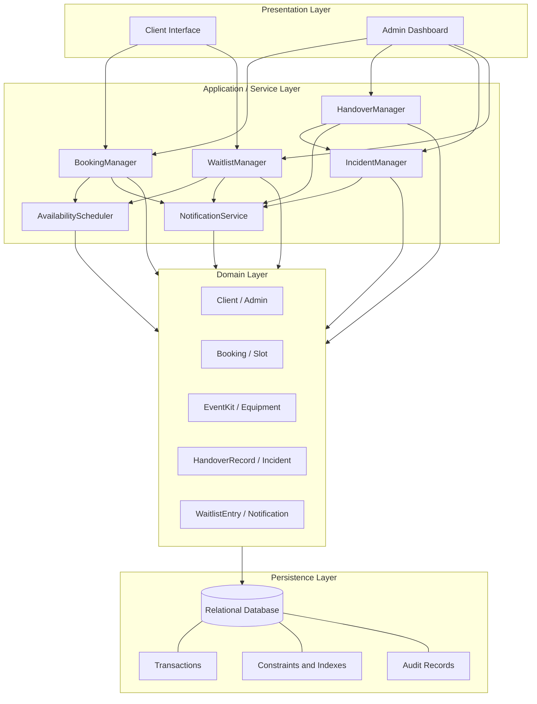
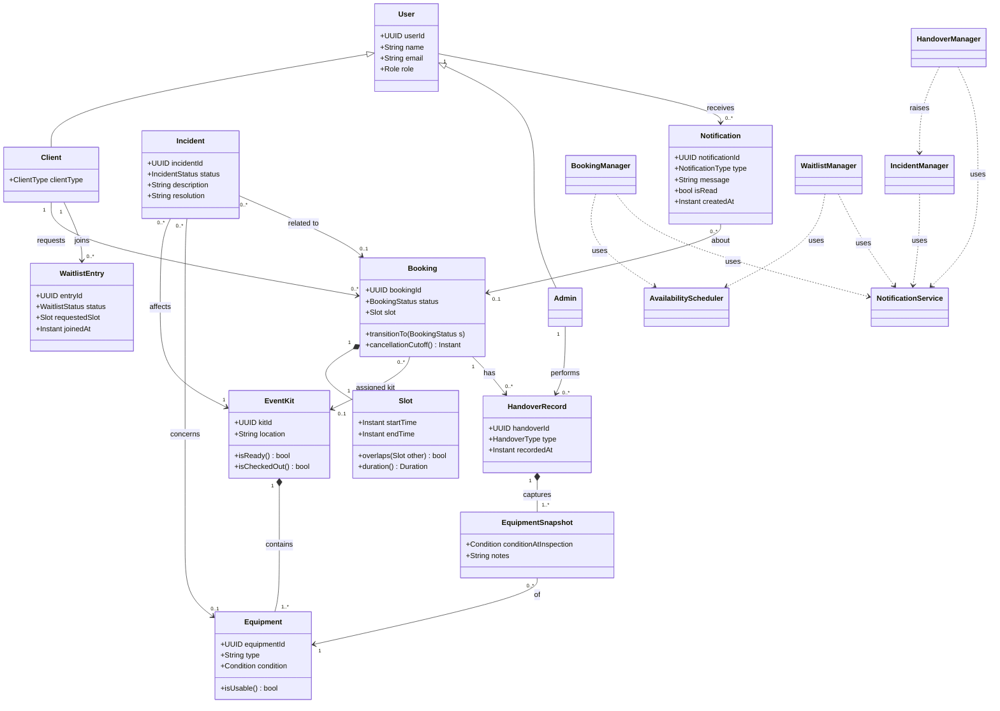
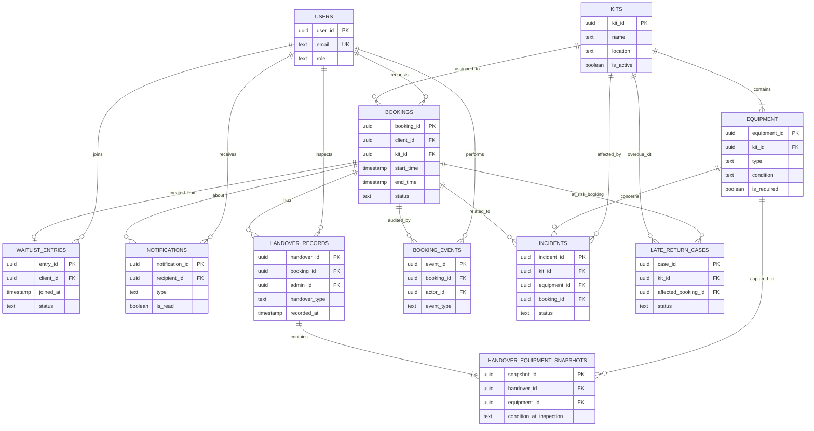
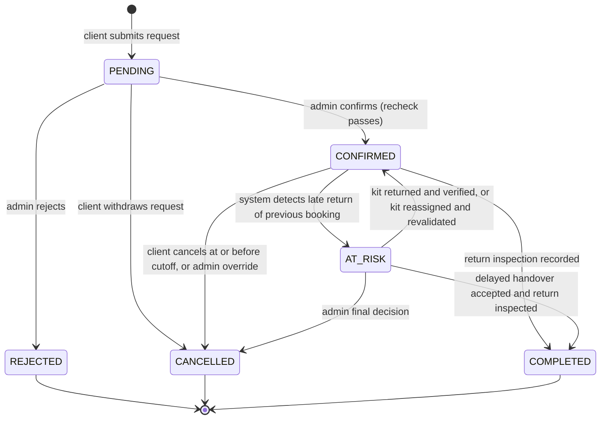
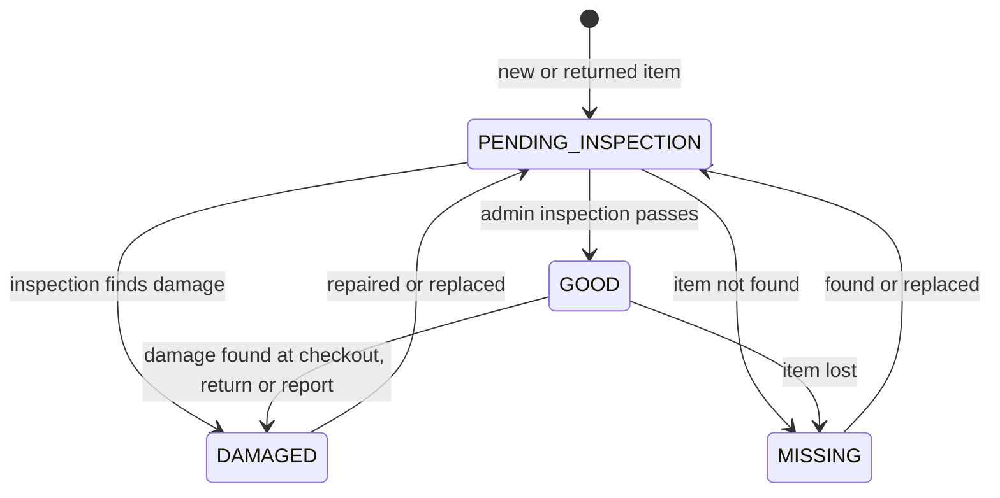
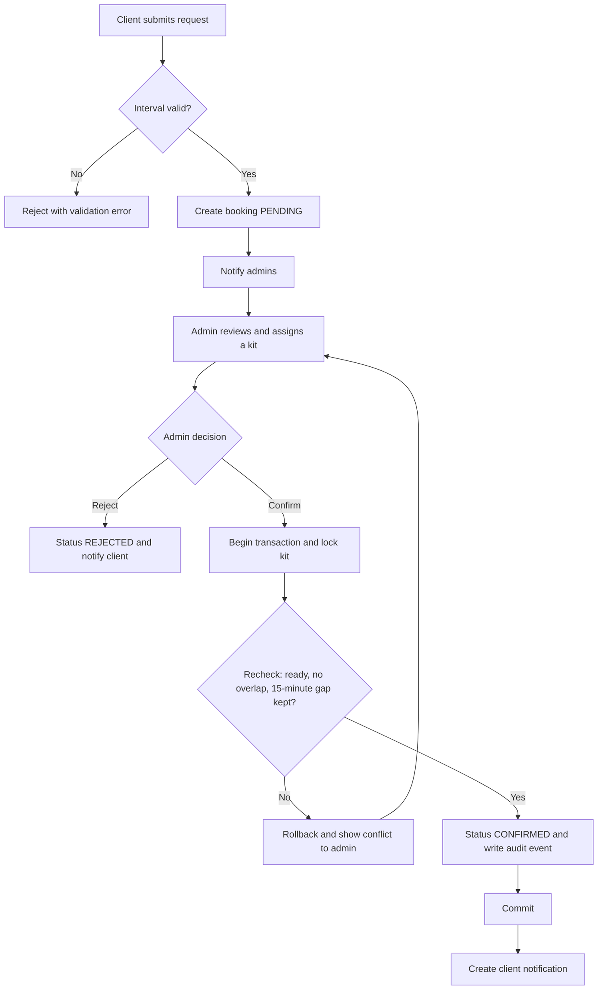
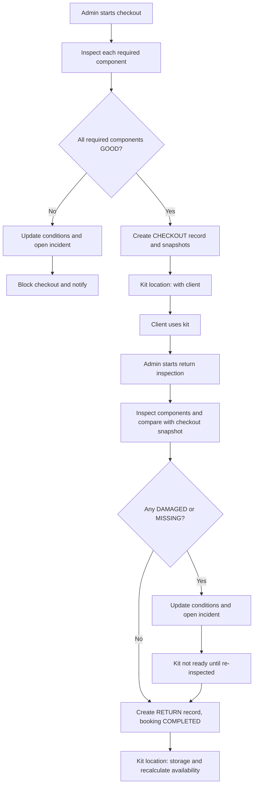
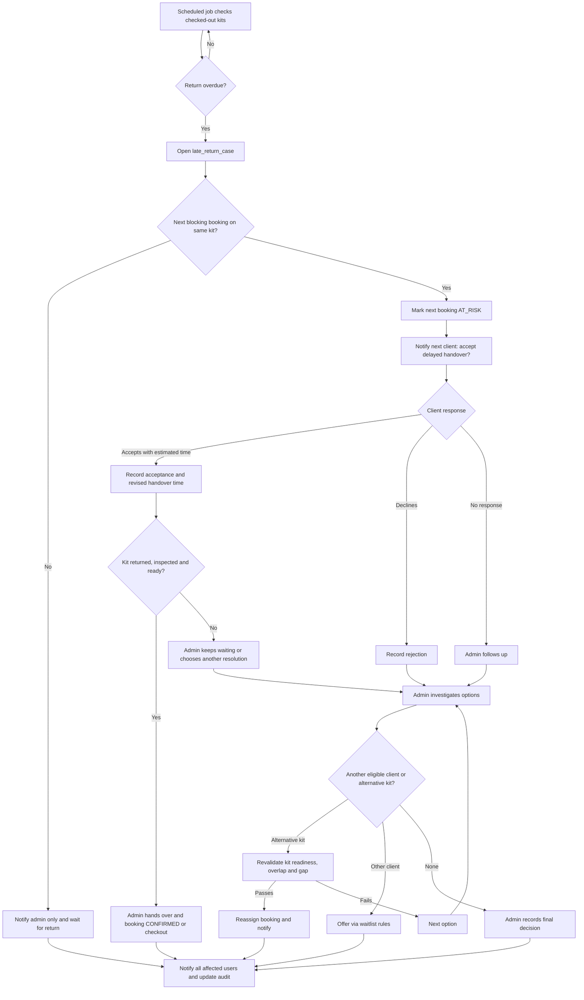

# Event Kit Rental System – System Design Document

Oct 10, 2026 · @surya

## 1. Title Page

| Field | Value |
| --- | --- |
| Project name | Event Kit Rental System |
| Document name | System Design Document (SDD) |
| Version | 0.1 (initial draft) |
| Document status | Draft for review |
| Date | 10 October 2026 |
| Prepared by | \[Name to be filled in\] |
| Institution / organization | \[To be filled in\] |

## 2. Document Control

### 2.1 Version History

| Version | Date | Author | Description |
| --- | --- | --- | --- |
| 0.1 | 2026-10-10 | \[Name to be filled in\] | Initial draft covering all 28 sections |

### 2.2 Purpose

This document defines the architecture, low-level design, data model, workflows, APIs and test approach of the Event Kit Rental System. It translates the finalized business requirements into an implementation-ready design.

### 2.3 Intended Audience

- Faculty members and evaluators reviewing the project.
- Teammates and developers who will implement the system.
- Future maintainers who need to understand why the design is shaped as it is.

### 2.4 Scope of the Document

The document covers the full initial version of the system: booking, kit assignment, inspection, incidents, late returns, waitlist and in-app notifications. It separates **confirmed requirements** (from the business brief) from **proposed design choices** (made here to satisfy those requirements). Proposed choices are labelled "Proposed". No programming language, framework, database product or hosting provider is approved, so none is assumed.

### 2.5 Terminology and Abbreviations

| Term | Meaning |
| --- | --- |
| SDD | System Design Document |
| LLD | Low-Level Design: classes, methods and data structures |
| FR / NFR | Functional / Non-Functional Requirement |
| RBAC | Role-Based Access Control |
| FIFO | First in, first out (first come, first served) |
| Kit | A physical bundle of components rented as one unit |
| Component | One physical item in a kit (camera, microphone, tripod, etc.) |
| UTC | Coordinated Universal Time, used for stored timestamps |
| API | Application Programming Interface |
| TBD | To be decided |

## 3. Executive Summary

The Event Kit Rental System lets college clubs, students and the general public request shared event kits (for example a camera, a microphone and a tripod) for a chosen time interval, while administrators review each request, assign a suitable kit and confirm or reject it.

**Problem solved.** Shared equipment is hard to manage manually: bookings clash, nobody knows what is damaged or missing, and late returns ripple into the next client's event. The system makes availability, equipment condition and communication explicit and traceable.

**Major features**

- Booking requests with fixed-duration slots or client-selected start and end times.
- Mandatory administrator approval and kit assignment, with availability rechecked at confirmation.
- Overlap prevention plus a 15-minute inspection gap between consecutive bookings of the same kit.
- Cancellation up to and including two hours before start.
- Component-level condition tracking with checkout and return inspection snapshots.
- Incident management for damaged or missing equipment.
- Late-return handling where the next client may accept or decline a delayed handover.
- First-come-first-served waitlist managed by administrators.
- Persisted in-app notifications, extensible to other channels later.

**Expected benefits.** Fewer double bookings, a clear inspection history, safer equipment handover, faster response to incidents, and a data model that already supports multiple kits so the system can grow without redesign. Rentals are free in this version; payments are out of scope.

## 4. Problem Statement

Managing shared event equipment by hand (messages, spreadsheets, memory) creates risks that this system is designed to prevent or manage. These are design motivations, not claims about past incidents.

| Problem | What can go wrong | How the system addresses it |
| --- | --- | --- |
| Double bookings | Two clients are promised the same kit for overlapping times | Database-enforced overlap prevention per kit and recheck at confirmation (Sections 13, 17) |
| Unclear availability | Clients and admins cannot tell when a kit is free | Availability computed from bookings, gap rule and readiness |
| Missing or damaged components | A kit is handed over without its microphone, or with a broken tripod | Component-level condition and mandatory inspection (Sections 15, 16) |
| Late returns | The next client waits with no information | Overdue detection, `AT_RISK` status and accept/decline flow (Section 18) |
| No inspection history | Disputes cannot be resolved because the earlier condition is unknown | Immutable inspection snapshots tied to booking and admin |
| Poor communication | Clients are not told about rejection, cancellation or delay | Persisted in-app notifications (Section 20) |
| Wasted cancelled slots | A released slot sits unused or is reassigned unfairly | FIFO waitlist with revalidation before any offer (Section 16.11) |

## 5. Goals and Objectives

| ID | Goal | Objective |
| --- | --- | --- |
| G-01 | Reliable booking management | Every request has a unique booking ID, a defined lifecycle and a recorded decision |
| G-02 | Conflict prevention | No two blocking bookings overlap on the same kit; a 15-minute gap is preserved |
| G-03 | Component-level condition tracking | Each component has its own `equipment_id` and condition |
| G-04 | Safe handover and return | Kits are handed over only when every required component is inspected and usable |
| G-05 | Incident management | Damage or loss creates a traceable incident with recovery and re-inspection |
| G-06 | In-app communication | Affected users are notified through persisted in-app notifications |
| G-07 | Multi-kit scalability | Data model and scheduling logic support many kits from day one |
| G-08 | Maintainability and extensibility | Logical modules and a provider interface allow later channels and features without rewriting booking logic |

## 6. Scope

### 6.1 In Scope

- Client and administrator workflows
- Booking requests and approvals
- Fixed and custom booking intervals
- Admin kit assignment
- Availability validation
- 15-minute scheduling gap (per kit)
- Two-hour cancellation cutoff
- Checkout and return inspection
- Incident management
- Late-return resolution
- Waitlist management
- In-app notifications
- Database persistence
- Authentication and authorization

### 6.2 Out of Scope for the Initial Version

- Online payments
- Deposits and rental pricing
- Late-fee processing
- Email, SMS and WhatsApp delivery
- Advanced demand forecasting
- Complex revenue optimization
- Microservices deployment

These items may appear only as future extensions (Section 25).

## 7. Stakeholders and User Roles

| Role | Description |
| --- | --- |
| Client | A college club, individual student or member of the public who requests, views and cancels their own bookings and answers offers |
| Administrator | Reviews requests, assigns kits, confirms or rejects, runs inspections, manages incidents, late-return decisions and waitlist offers |
| System | Automated actor: validates rules, detects overdue returns, creates notifications, runs scheduled jobs, writes audit records |
| Maintenance staff (optional, future) | Would repair or replace components and report them ready for re-inspection; not part of the initial version |

### 7.1 Role-Permission Matrix

Legend: Y = allowed, Own = only on the user's own records, N = not allowed, Future = proposed future role.

| Capability | Client | Administrator | Maintenance (future) |
| --- | --- | --- | --- |
| Register / log in | Y | Y | Future |
| Submit booking request | Y | N | N |
| View own bookings and history | Own | Y (all) | N |
| Cancel a booking before cutoff | Own | Y | N |
| Cancel after cutoff (override with reason) | N | Y (audited) | N |
| Approve / reject booking | N | Y | N |
| Assign or reassign kit | N | Y | N |
| View availability (without kit internals) | Y | Y | N |
| Manage kits and components | N | Y | Future (condition updates) |
| Perform checkout and return inspection | N | Y | N |
| Create / resolve incidents | N | Y | Future (repair updates) |
| Respond to late-handover request | Own | N | N |
| Decide final late-return outcome | N | Y | N |
| Join waitlist | Y | N | N |
| Accept / decline waitlist offer | Own | N | N |
| Create waitlist offers | N | Y | N |
| Read own notifications | Own | Own | Future |
| View audit history | N | Y | N |

## 8. Functional Requirements

All requirements below derive from the confirmed business requirements. Each has a unique ID, and the *Realized in* column points to the section that designs it.

### 8.1 Registration and Authentication

| ID | Name | Description | Actor | Preconditions | Expected result | Realized in |
| --- | --- | --- | --- | --- | --- | --- |
| FR-01 | Client registration | Register with name, email, password and client type (club, student, public) | Client | Email not already registered | Account created with role CLIENT; password stored only as a hash | 16.1, 21 |
| FR-02 | Login and session | Authenticate and receive a session/token carrying the role | Client, Admin | Account exists and is active | Authenticated session; failed attempts rejected and rate limited | 16.1, 19, 21 |
| FR-03 | Role-based authorization | Every action is permitted only for roles authorized for it | System | Authenticated user | Unauthorized actions rejected with 403 and logged | 7, 19, 21 |

### 8.2 Booking Creation, Time Validation, Availability

| ID | Name | Description | Actor | Preconditions | Expected result | Realized in |
| --- | --- | --- | --- | --- | --- | --- |
| FR-04 | Create booking request | Submit a request for a fixed-duration slot or a custom start/end time | Client | Logged in as client | Booking with unique `booking_id` in `PENDING` | 16.2 |
| FR-05 | Time validation | Reject intervals where end is not after start, start is in the past, or duration is outside the allowed minimum/maximum | System | Request submitted | Valid request accepted; invalid request rejected with a clear error | 17, 22 |
| FR-06 | Availability check | Determine which kits could serve an interval (readiness, overlap, 15-minute gap) | System, Admin | Valid interval | List of eligible kits (informational, not a reservation) | 17 |
| FR-07 | Admin kit assignment | Administrator selects a suitable kit for a pending booking | Admin | Booking is `PENDING` | Kit proposed for booking after eligibility check | 16.3 |

### 8.3 Confirmation, Rejection, Cancellation

| ID | Name | Description | Actor | Preconditions | Expected result | Realized in |
| --- | --- | --- | --- | --- | --- | --- |
| FR-08 | Confirm booking | Recheck availability and readiness at confirmation, then confirm atomically | Admin | Booking `PENDING`, kit assigned | Booking `CONFIRMED`; client notified; audit event written | 14, 16.3, 17 |
| FR-09 | Reject booking | Reject with a reason | Admin | Booking `PENDING` | Booking `REJECTED`; client notified | 14 |
| FR-10 | Client cancellation | Cancel a confirmed booking up to and including `start_time - 2 hours` | Client | Booking `CONFIRMED`, now <= cutoff | Booking `CANCELLED`; reservation released; availability recalculated | 16.5 |
| FR-11 | Admin cancellation override | Cancel after cutoff in exceptional cases with reason and admin identity recorded | Admin | Booking `CONFIRMED` or `AT_RISK` | Booking `CANCELLED`; override recorded in audit history | 16.5 |
| FR-12 | Release without checkout loss | Cancellation never makes a physically checked-out kit available | System | Cancellation processed | Kit stays unavailable until returned and inspected | 15, 16.5 |

### 8.4 Kit, Component, Checkout and Return

| ID | Name | Description | Actor | Preconditions | Expected result | Realized in |
| --- | --- | --- | --- | --- | --- | --- |
| FR-13 | Kit and component registry | Create kits with a unique `kit_id` and components with unique `equipment_id` | Admin | Admin logged in | Kit and components stored | 13, 15 |
| FR-14 | Component condition tracking | Track `GOOD`, `DAMAGED`, `MISSING`, `PENDING_INSPECTION` per component | Admin, System | Component exists | Current condition stored per component | 15 |
| FR-15 | Derived readiness | Compute kit readiness from components and inspection data, never set by hand | System | Kit exists | Readiness always consistent with component data | 15 |
| FR-16 | Kit location tracking | Track physical location separately from condition and availability | Admin | Kit exists | Location stored independently | 15 |
| FR-17 | Checkout inspection | Inspect all required components, record timestamp, booking and admin | Admin | Booking `CONFIRMED`, kit ready | Checkout record and per-component snapshots saved; kit marked checked out | 16.6 |
| FR-18 | Return inspection | Inspect all components on return and record differences from checkout | Admin | Kit checked out for the booking | Return record and snapshots saved; differences stored; conditions updated | 16.7 |
| FR-19 | Handover blocking | A damaged, missing or uninspected component blocks handover | System | Checkout attempted | Checkout refused with the blocking components listed | 15, 16.6 |

### 8.5 Incidents, Late Returns, Waitlist

| ID | Name | Description | Actor | Preconditions | Expected result | Realized in |
| --- | --- | --- | --- | --- | --- | --- |
| FR-20 | Create incident | Create an incident for damaged, missing or unusable equipment | Admin, System | Component affected | Incident `OPEN`; component condition updated | 16.8 |
| FR-21 | Affected-booking identification | Identify upcoming bookings of the affected kit | System | Incident open | List of affected bookings; admin and clients notified | 16.8 |
| FR-22 | Incident recovery | Track repair, replacement and resolution; require inspection before use | Admin | Incident open | Incident resolved only after recovery; readiness requires separate inspection | 15, 16.8 |
| FR-23 | Overdue detection | Detect kits not returned by the expected time | System | Kit checked out past `end_time` | Overdue flag raised; next booking identified | 18 |
| FR-24 | At-risk marking and notification | Mark the next booking `AT_RISK` and ask the client to accept or decline a delayed handover | System | Next booking exists on same kit | Booking `AT_RISK`; client notified | 18 |
| FR-25 | Client late-handover response | Record acceptance or rejection with estimated revised handover time | Client | Booking `AT_RISK` | Response stored; admin notified | 18 |
| FR-26 | Late-return resolution | Admin makes the final decision; acceptance does not bypass inspection | Admin | Client responded or timed out | Decision stored; affected users notified | 18 |
| FR-27 | Alternative kit assignment | Reassign to another kit that independently passes all checks | Admin | Alternative kit exists | Booking moved atomically or admin informed no kit qualifies | 16.10 |
| FR-28 | Join waitlist | Record a waitlist entry with the requested interval and join time | Client | Requested slot unavailable | Entry `WAITING` ordered FIFO | 16.11 |
| FR-29 | Waitlist offer | Admin offers a freed slot to the earliest eligible entry after revalidation | Admin | Slot revalidated as free and ready | Offer sent; entry `OFFERED` | 16.11 |
| FR-30 | Offer response | Client accepts, declines or lets the offer expire; outcome recorded | Client, System | Entry `OFFERED` | Acceptance creates a `PENDING` booking, still needing assignment and confirmation | 16.11 |

### 8.6 Notifications, History, Audit

| ID | Name | Description | Actor | Preconditions | Expected result | Realized in |
| --- | --- | --- | --- | --- | --- | --- |
| FR-31 | In-app notifications | Create persisted notifications for confirmation, rejection, cancellation, reminders, late-return decisions, incidents, waitlist offers | System | Triggering event committed | Notification stored with unique ID, recipient, type, message, time, read status, optional booking | 16.12, 20 |
| FR-32 | Read and mark notifications | List and mark own notifications read | Client, Admin | Logged in | Read status updated | 16.12 |
| FR-33 | Booking history | Clients see their own bookings; admins see all with filters | Client, Admin | Logged in | Authorized history list | 19 |
| FR-34 | Audit history | Record every booking state change, override, assignment and inspection with actor and time | System | Any state-changing action | Immutable `booking_events` rows | 13, 21 |

## 9. Non-Functional Requirements

The **Type** column separates a *Measurable target* (a number to verify) from a *Design goal* (a qualitative property). No performance numbers were specified in the business requirements, so every numeric value below is a **Proposed target** pending approval, or TBD.

| ID | Category | Requirement | Type | Status |
| --- | --- | --- | --- | --- |
| NFR-01 | Correctness | The 15-minute gap and two-hour cutoff are applied exactly as specified, for the same kit only | Design goal (tested at boundaries) | Confirmed rule |
| NFR-02 | Data consistency | Reservation, status change and audit record commit atomically; no two blocking bookings overlap on one kit | Design goal | Confirmed rule |
| NFR-03 | Reliability | A notification failure never rolls back a committed booking | Design goal | Confirmed rule |
| NFR-04 | Security | Passwords hashed; TLS in transit; secrets outside source code | Design goal | Proposed |
| NFR-05 | Authorization | Every endpoint enforces role and ownership checks server-side | Design goal | Confirmed rule |
| NFR-06 | Performance | Typical availability query and booking request respond within a short interval | Measurable target | Proposed: 95% of requests under 2 s with the expected initial load; TBD |
| NFR-07 | Maintainability | Logical modules with single responsibilities; no business logic in the presentation layer | Design goal | Proposed |
| NFR-08 | Scalability | Data model and algorithms support many kits and more users without redesign | Design goal | Confirmed rule |
| NFR-09 | Auditability | All state changes record actor, time and reason where relevant | Design goal | Confirmed rule |
| NFR-10 | Usability | Clear error messages, visible booking status, unread notification indicator | Design goal | Proposed |
| NFR-11 | Timezone correctness | Store timestamps in UTC; display in the institution's configured timezone; compute cutoff and gap in absolute time | Design goal | Proposed; institution timezone TBD |
| NFR-12 | Recoverability | Data restorable from backups; interrupted operations leave consistent data | Measurable target | Proposed: backup frequency and recovery time TBD |
| NFR-13 | Availability of service | Booking system reachable during normal college hours | Measurable target | TBD |
| NFR-14 | Data minimization | Store only data needed for bookings and accountability | Design goal | Proposed |

## 10. Assumptions and Constraints

### 10.1 Confirmed Assumptions and Constraints

- The initial deployment may operate with a single kit; the data model and scheduling logic support many kits.
- All rentals are free; no payment, deposit or late-fee logic exists.
- Notifications are in-app only.
- Administrators manually approve bookings and assign kits.
- A persistent relational database is required.
- The 15-minute gap applies per kit, never globally.
- Cancellation cutoff is exactly `start_time - 2 hours`.

### 10.2 Open Implementation Decisions

| Decision | Status |
| --- | --- |
| Programming language, framework, hosting provider | Not specified; not assumed |
| Database product | Not specified; design requires transactions and range/exclusion-style constraint support or an equivalent locking approach (Section 13) |
| Minimum and maximum booking duration | TBD (parameters, not hard-coded) |
| Fixed slot lengths offered | TBD (configurable list) |
| Institution timezone | TBD |
| Waitlist offer expiry period | TBD |
| Late-return grace period before marking overdue | TBD |
| Whether administrators may override the cancellation cutoff | Proposed as optional, audited (FR-11) |
| Reminder lead time before a booking | TBD |

## 11. High-Level System Architecture

The system is a **modular application** with four logical layers. The modules are logical boundaries inside one deployable application; they are **not** separate microservices.



**Reading the diagram.** Requests flow downward. Clients and administrators use the presentation layer, which calls the application services. Services apply business rules using domain objects and persist everything through the relational database. `AvailabilityScheduler` is shared by booking and waitlist logic so the overlap and gap rules live in exactly one place. `NotificationService` is called after state changes and is the only module that creates notifications.

### 11.1 Layer Responsibilities and Dependencies

| Layer | Responsibilities | Depends on |
| --- | --- | --- |
| Presentation | Display forms and lists, collect input, show notifications; no business rules, only basic input checks | Application layer (via the API in Section 19) |
| Application / service | Orchestrate use cases, enforce authorization, run transactions, apply scheduling and policy rules | Domain and persistence layers |
| Domain | Hold entities, their state and the rules that depend only on their own data (for example a booking's allowed transitions) | Nothing above it |
| Persistence | Store data durably, guarantee atomicity, enforce integrity constraints, keep audit rows | Database engine (not yet selected) |

### 11.2 Module Summary

| Module | Responsibility |
| --- | --- |
| BookingManager | Create, assign, confirm, reject, cancel and complete bookings |
| AvailabilityScheduler | Evaluate whether a kit is eligible for an interval (readiness, overlap, 15-minute gap) |
| HandoverManager | Checkout and return inspections, snapshots, kit checked-out state |
| IncidentManager | Create, track and resolve incidents; identify affected bookings |
| WaitlistManager | FIFO waitlist entries and admin-driven offers |
| NotificationService | Create and persist notifications; later route to other channels |

These modules may later be split into separate deployable services if needed, but nothing in the design requires it.

## 12. Low-Level Design and Class Responsibilities

**Design rule.** Domain entities own behaviour that depends only on their own data (state-transition guards, simple validation). Application services own behaviour that spans several entities, needs the database, or sends notifications. `Admin` and `Client` are roles of one `User` base concept; kit readiness and kit availability are **derived**, never stored.



**Reading the diagram.** A `Client` requests many `Booking`s; each booking owns exactly one `Slot` (time interval) and may be assigned one `EventKit`. A kit contains one or more `Equipment` items. Each `HandoverRecord` (checkout or return) belongs to a booking and an admin and owns one `EquipmentSnapshot` per inspected component. An `Incident` affects a kit, optionally a specific component and booking. Dashed arrows show service-to-service use.

### 12.1 Domain Entities

| Class | Purpose | Key attributes | Key methods | Relationships |
| --- | --- | --- | --- | --- |
| `Client` | A club, student or public user who rents kits | `userId`, `name`, `email`, `clientType` | `requestBooking()` (delegates to `BookingManager`) | Has many bookings, waitlist entries, notifications |
| `Admin` | Staff who approve, inspect and resolve | `userId`, `name`, `email` | none beyond identity; actions run through services | Performs inspections, decisions |
| `Slot` | Immutable value object for a half-open interval `[start, end)` | `startTime`, `endTime` | `overlaps(other)`, `duration()`, `isValid()` | Owned by `Booking` and `WaitlistEntry` |
| `Booking` | One rental request and its lifecycle | `bookingId`, `status`, `slot`, `clientId`, `kitId?`, `lateHandoverResponse?`, `revisedHandoverTime?` | `cancellationCutoff()`, `canTransitionTo(s)`, `isBlocking()` | Client 1..*; Kit 0..1; Handover 0..* |
| `Equipment` | One physical component | `equipmentId`, `kitId`, `type`, `condition` | `isUsable()` (condition is `GOOD`) | Belongs to one kit |
| `EventKit` | A rentable bundle of components | `kitId`, `name`, `location`, `isActive` | `isReady()` (derived), `isCheckedOut()` (derived from open handover) | Has 1..\* equipment |
| `HandoverRecord` | One checkout or return inspection event | `handoverId`, `bookingId`, `adminId`, `type` (CHECKOUT/RETURN), `recordedAt` | `differencesFrom(checkoutRecord)` | Has 1..\* snapshots |
| `Incident` | Damage, loss or unusability case | `incidentId`, `kitId`, `equipmentId?`, `bookingId?`, `description`, `status`, `resolution`, `createdAt`, `resolvedAt` | `resolve(resolution)` guarded by status | Affects one kit |
| `WaitlistEntry` | A queued interest in an interval; not a reservation | `entryId`, `clientId`, `requestedSlot`, `joinedAt`, `status`, `offerExpiresAt?` | `canTransitionTo(s)` | Belongs to one client |
| `Notification` | A persisted in-app message | `notificationId`, `recipientId`, `type`, `message`, `createdAt`, `isRead`, `bookingId?` | `markRead()` | Belongs to one recipient |

### 12.2 Application Services

| Service | Purpose | Conceptual methods |
| --- | --- | --- |
| `BookingManager` | Orchestrates the booking lifecycle in transactions | `createRequest(clientId, slot)`, `assignKit(bookingId, kitId, adminId)`, `confirm(bookingId, adminId)`, `reject(bookingId, adminId, reason)`, `cancel(bookingId, actor, reason?)`, `markAtRisk(bookingId)`, `complete(bookingId)` |
| `AvailabilityScheduler` | Single owner of eligibility, overlap and gap rules | `isKitEligible(kitId, slot, excludeBookingId?)`, `findEligibleKits(slot)`, `nextBlockingBooking(kitId, after)` |
| `HandoverManager` | Checkout and return inspection | `checkout(bookingId, adminId, inspectedItems)`, `returnKit(bookingId, adminId, inspectedItems)`, `detectOverdue(now)` |
| `IncidentManager` | Incident lifecycle and impact analysis | `open(kitId, equipmentId, bookingId?, description)`, `affectedBookings(kitId)`, `recordRecovery(incidentId, note)`, `resolve(incidentId, adminId, resolution)` |
| `WaitlistManager` | FIFO queue and offers | `join(clientId, slot)`, `nextEligible(slot)`, `offer(entryId, adminId)`, `respond(entryId, decision)`, `expireOffers(now)` |
| `NotificationService` | Create and deliver notifications through a provider interface | `notify(recipientId, type, message, bookingId?)`, `list(userId)`, `markRead(id, userId)` |

### 12.3 What Lives Where

- **In entities:** time-interval arithmetic (`Slot`), allowed status transitions, derived booleans such as `isUsable()`.
- **In services:** anything that queries other bookings, locks rows, writes audit events, changes several tables, or sends notifications.
- **Not stored:** kit readiness, kit availability and "checked out" are derived from components, inspections and handover records, so they cannot disagree with them.

## 13. Database Design

This is a **proposed** normalized relational schema. Data types are conceptual (UUID, text, integer, boolean, timestamp in UTC, enum). No database product is assumed.



**Reading the diagram.** Users own bookings, waitlist entries and notifications. A kit contains equipment and is assigned to bookings. A booking has handover records (checkout and return), each with one snapshot row per inspected component. Incidents link a kit, optionally a component and a booking. `booking_events` is the audit trail. `late_return_cases` stores the overdue-return decision flow so it is not squeezed into the bookings table.

### 13.1 Design Decisions

| Decision | Reason |
| --- | --- |
| One `users` table with a `role` column (`CLIENT`, `ADMIN`; `MAINTENANCE` reserved for later) | Clients and admins share identity, login and notification recipient data. Separate tables would duplicate those columns and force two foreign keys on every notification and audit row. Client-specific data (`client_type`) is a nullable column. |
| Readiness is **not** stored | It is computed from `equipment.condition`, required flags and the latest inspection, so it cannot drift from the facts it depends on. |
| Availability is **not** stored | It is computed from blocking bookings, the gap rule, location/checkout state and readiness. |
| Checked-out state is derived | A kit is checked out when a `CHECKOUT` handover exists for a booking with no later `RETURN` handover. This keeps booking status separate from physical handover status. |
| Current condition vs history | `equipment.condition` holds the **current** value; `handover_equipment_snapshots` holds immutable **historical** values per inspection. |
| Time stored as UTC instants | Avoids daylight-saving and timezone ambiguity. |

### 13.2 Table Definitions

#### `users`

**Purpose:** identity, login and role for every person. **PK:** `user_id`.

| Column | Type | Constraints / notes |
| --- | --- | --- |
| user\_id | UUID | PK |
| name | text | NOT NULL |
| email | text | NOT NULL, UNIQUE |
| password\_hash | text | NOT NULL; salted slow hash, never a raw password |
| role | enum | NOT NULL; `CLIENT`, `ADMIN` (`MAINTENANCE` future) |
| client\_type | enum | NULL for admins; `CLUB`, `STUDENT`, `PUBLIC` for clients; CHECK role=`CLIENT` implies not null |
| is\_active | boolean | NOT NULL default true |
| created\_at | timestamp | NOT NULL |

**Indexes:** unique on `email`.

#### `kits`

**Purpose:** one physical kit. Condition and readiness are derived from `equipment`. **PK:** `kit_id`.

| Column | Type | Constraints / notes |
| --- | --- | --- |
| kit\_id | UUID | PK |
| name | text | NOT NULL, UNIQUE (for example "Kit A") |
| location | enum/text | NOT NULL; physical location (for example `STORAGE`, `WITH_CLIENT`, `UNDER_REPAIR`); independent of condition and scheduling |
| is\_active | boolean | NOT NULL; retired kits are excluded from scheduling |
| created\_at | timestamp | NOT NULL |

#### `equipment`

**Purpose:** one physical component and its **current** condition. **PK:** `equipment_id`. **FK:** `kit_id` to `kits`.

| Column | Type | Constraints / notes |
| --- | --- | --- |
| equipment\_id | UUID | PK |
| kit\_id | UUID | FK to `kits`, NOT NULL |
| type | text | NOT NULL (camera, microphone, tripod, configurable) |
| serial\_label | text | optional unique tag printed on the item |
| condition | enum | NOT NULL; `GOOD`, `DAMAGED`, `MISSING`, `PENDING_INSPECTION` |
| is\_required | boolean | NOT NULL; required components must be `GOOD` for readiness |
| updated\_at | timestamp | NOT NULL |

**Indexes:** `kit_id`; (`kit_id`, `condition`).

#### `bookings`

**Purpose:** one rental request and its decision lifecycle. **PK:** `booking_id`. **FKs:** `client_id` to `users`, `kit_id` to `kits` (nullable until assigned).

| Column | Type | Constraints / notes |
| --- | --- | --- |
| booking\_id | UUID | PK, unique booking ID |
| client\_id | UUID | FK to `users`, NOT NULL |
| kit\_id | UUID | FK to `kits`, NULL while unassigned |
| start\_time | timestamp | NOT NULL |
| end\_time | timestamp | NOT NULL; CHECK `end_time > start_time` |
| held\_until | timestamp | NOT NULL; equals `end_time + 15 minutes`, set by the application from configuration (proposed) |
| slot\_type | enum | `FIXED`, `CUSTOM` |
| status | enum | NOT NULL; `PENDING`, `CONFIRMED`, `AT_RISK`, `CANCELLED`, `REJECTED`, `COMPLETED` |
| purpose | text | optional description of the event |
| decision\_reason | text | rejection or cancellation reason |
| revised\_handover\_time | timestamp | NULL; set from an accepted late handover |
| created\_at / updated\_at | timestamp | NOT NULL |
| version | integer | optimistic-lock counter |

**Key constraint (conflict prevention):** for rows with `kit_id` not null and `status` in (`CONFIRMED`, `AT_RISK`), no two rows with the same `kit_id` may have overlapping ranges `[start_time, held_until)`. Where the database supports exclusion constraints this is declared directly; otherwise it is enforced by locking the kit row (Section 13.4). **Indexes:** (`kit_id`, `start_time`, `held_until`) for overlap queries; (`client_id`, `start_time`); (`status`, `start_time`).

#### `handover_records`

**Purpose:** one checkout or return inspection for a booking, with who did it and when. **PK:** `handover_id`. **FKs:** `booking_id`, `admin_id`.

| Column | Type | Constraints / notes |
| --- | --- | --- |
| handover\_id | UUID | PK |
| booking\_id | UUID | FK to `bookings`, NOT NULL |
| kit\_id | UUID | FK to `kits`, NOT NULL (the kit physically inspected) |
| admin\_id | UUID | FK to `users` (role `ADMIN`), NOT NULL |
| handover\_type | enum | `CHECKOUT` or `RETURN` |
| recorded\_at | timestamp | NOT NULL |
| notes | text | optional |

**Constraints:** UNIQUE (`booking_id`, `handover_type`) so a booking has at most one checkout and one return. **Indexes:** `booking_id`; (`kit_id`, `handover_type`, `recorded_at`).

#### `handover_equipment_snapshots`

**Purpose:** immutable record of each component's condition at one inspection. **PK:** `snapshot_id`. **FKs:** `handover_id`, `equipment_id`.

| Column | Type | Constraints / notes |
| --- | --- | --- |
| snapshot\_id | UUID | PK |
| handover\_id | UUID | FK to `handover_records`, NOT NULL |
| equipment\_id | UUID | FK to `equipment`, NOT NULL |
| condition\_at\_inspection | enum | NOT NULL; same values as `equipment.condition` |
| notes | text | optional |

**Constraints:** UNIQUE (`handover_id`, `equipment_id`); rows are never updated or deleted. Differences between checkout and return are found by joining the two snapshots for the same booking and component.

#### `incidents`

**Purpose:** a damage, loss or unusability case. **PK:** `incident_id`. **FKs:** `kit_id`, `equipment_id` (nullable), `booking_id` (nullable), `reported_by`.

| Column | Type | Constraints / notes |
| --- | --- | --- |
| incident\_id | UUID | PK |
| kit\_id | UUID | FK, NOT NULL |
| equipment\_id | UUID | FK, NULL if the whole kit |
| booking\_id | UUID | FK, NULL when not tied to a rental |
| description | text | NOT NULL |
| status | enum | `OPEN`, `IN_RECOVERY`, `RESOLVED` |
| resolution | text | NULL until resolved; required when `RESOLVED` |
| reported\_by | UUID | FK to `users` |
| created\_at / resolved\_at | timestamp | `resolved_at` NULL until resolved |

**Indexes:** (`kit_id`, `status`).

#### `waitlist_entries`

**Purpose:** a queued request for a slot. It reserves nothing. **PK:** `entry_id`. **FKs:** `client_id`, `resulting_booking_id` (nullable).

| Column | Type | Constraints / notes |
| --- | --- | --- |
| entry\_id | UUID | PK |
| client\_id | UUID | FK to `users`, NOT NULL |
| requested\_start / requested\_end | timestamp | NOT NULL; end after start |
| joined\_at | timestamp | NOT NULL; defines FIFO order together with `entry_id` as tiebreaker |
| status | enum | `WAITING`, `OFFERED`, `ACCEPTED`, `DECLINED`, `EXPIRED`, `CANCELLED` |
| offered\_at / offer\_expires\_at | timestamp | NULL until offered |
| decided\_by\_admin\_id | UUID | FK to `users`, NULL |
| resulting\_booking\_id | UUID | FK to `bookings`, NULL |

**Indexes:** (`status`, `requested_start`, `joined_at`).

#### `notifications`

**Purpose:** persisted in-app messages. **PK:** `notification_id`. **FKs:** `recipient_id`, `booking_id` (nullable).

| Column | Type | Constraints / notes |
| --- | --- | --- |
| notification\_id | UUID | PK |
| recipient\_id | UUID | FK to `users`, NOT NULL |
| type | enum | for example `BOOKING_CONFIRMED`, `BOOKING_REJECTED`, `BOOKING_CANCELLED`, `REMINDER`, `LATE_RETURN`, `INCIDENT`, `WAITLIST_OFFER` |
| message | text | NOT NULL |
| booking\_id | UUID | FK, optional |
| incident\_id | UUID | FK, optional |
| is\_read | boolean | NOT NULL default false |
| created\_at / read\_at | timestamp | `read_at` NULL until read |

**Indexes:** (`recipient_id`, `is_read`, `created_at` descending).

#### `booking_events`

**Purpose:** append-only audit trail. **PK:** `event_id`. **FKs:** `booking_id`, `actor_id` (null for system actions).

| Column | Type | Constraints / notes |
| --- | --- | --- |
| event\_id | UUID | PK |
| booking\_id | UUID | FK, NOT NULL |
| actor\_id | UUID | FK to `users`; NULL means the system |
| event\_type | enum | `CREATED`, `KIT_ASSIGNED`, `CONFIRMED`, `REJECTED`, `CANCELLED`, `CANCEL_OVERRIDE`, `MARKED_AT_RISK`, `CHECKED_OUT`, `RETURNED`, `COMPLETED`, `KIT_REASSIGNED` |
| from\_status / to\_status | enum | status before and after, where applicable |
| reason | text | required for rejection and override |
| created\_at | timestamp | NOT NULL |

**Constraints:** rows are insert-only. **Indexes:** (`booking_id`, `created_at`).

#### `late_return_cases`

**Purpose:** records the client's answer and the admin's final decision for a late return (Section 18). **PK:** `case_id`. **FKs:** `kit_id`, `overdue_booking_id`, `affected_booking_id`, `decided_by_admin_id`.

| Column | Type | Constraints / notes |
| --- | --- | --- |
| case\_id | UUID | PK |
| kit\_id | UUID | FK, NOT NULL |
| overdue\_booking\_id | UUID | FK to the booking not yet returned |
| affected\_booking\_id | UUID | FK to the next booking on the same kit |
| status | enum | `AWAITING_CLIENT`, `CLIENT_ACCEPTED`, `CLIENT_DECLINED`, `ADMIN_DECIDED` |
| client\_response | enum | `ACCEPTED`, `REJECTED`, NULL until answered |
| estimated\_handover\_time | timestamp | NULL until the client or admin supplies it |
| admin\_decision | enum | `PROCEED_WITH_DELAY`, `REASSIGN_KIT`, `OFFER_OTHER_CLIENT`, `CANCEL_BY_ADMIN` or equivalent; NULL until decided |
| decision\_note | text | optional |
| decided\_by\_admin\_id | UUID | FK, NULL until decided |
| created\_at / responded\_at / decided\_at | timestamp | as applicable |

### 13.3 Normalization Notes

- Every non-key column depends on its table's key only (3NF). Client name and email live only in `users`; bookings reference the user.
- Snapshots store condition at a moment in time, which is a distinct fact from the current condition, so they are not duplication.
- `held_until` is a deliberate stored derivation (`end_time` plus the gap) that lets the overlap constraint be expressed on one range. It is written by one code path and covered by a CHECK that it equals `end_time` plus the configured gap.
- Booking status, handover (checkout/return) state, incident status, derived readiness, derived availability and kit location are six separate concepts and none is encoded in another's column.

### 13.4 Transactions and Concurrency Control

An application-level "is the kit free?" query followed by an insert is **not** safe: two admins can both see it free and both confirm. The design uses three layers.

1. **Atomic transaction.** Confirmation runs in one transaction: lock, recheck, update status, write audit event. If any step fails, everything rolls back.
2. **Pessimistic lock on the kit.** Inside the transaction the application locks the `kits` row for the assigned `kit_id` (for example a `SELECT ... FOR UPDATE` equivalent), so concurrent confirmations for the same kit are serialized. Other kits are not blocked, so simultaneous multi-kit use stays fast.
3. **Database constraint as the final guard.** The overlap rule on `[start_time, held_until)` for blocking statuses is declared as a constraint where the database supports it. If a bug or a race slips past the application, the database rejects the second write with a conflict error that the API maps to HTTP 409.

Optimistic `version` columns on `bookings` additionally detect that two admins edited the same booking at once; the second update fails and the admin must reload.

Notifications are created **after** the booking transaction commits (or in a separate transaction), so a notification failure cannot undo a confirmed booking.

## 14. Booking State Machine



**Reading the diagram.** A request starts as `PENDING`. The admin either confirms it (after an availability recheck) or rejects it. A confirmed booking can be cancelled, can become `AT_RISK` if the previous renter has not returned the kit, and finally becomes `COMPLETED` after the return inspection. `AT_RISK` returns to `CONFIRMED` when the problem is solved, or ends in `CANCELLED` by an admin decision. `REJECTED`, `CANCELLED` and `COMPLETED` are final.

### 14.1 State Definitions

| State | Meaning | Blocks the kit's calendar? |
| --- | --- | --- |
| `PENDING` | Request received, awaiting admin review; a kit may be tentatively proposed but nothing is reserved | No |
| `CONFIRMED` | Admin approved and a kit is reserved for the interval | Yes |
| `AT_RISK` | Confirmed, but the planned handover may be delayed or impossible (late return, incident); still holds the reservation until resolved | Yes |
| `CANCELLED` | Ended by the client, or by an admin (including override or late-return decision) | No |
| `REJECTED` | Admin declined the request | No |
| `COMPLETED` | Kit returned and return inspection recorded; rental finished | No |

### 14.2 Transition Table

| From | To | Actor | Preconditions | Notification | Audit event |
| --- | --- | --- | --- | --- | --- |
| (new) | `PENDING` | Client | Valid interval, not in the past, duration within limits | Admin: new request | `CREATED` |
| `PENDING` | `CONFIRMED` | Admin | Kit assigned; kit eligible at confirmation time (Section 17); version matches | Client: confirmed | `KIT_ASSIGNED`, `CONFIRMED` |
| `PENDING` | `REJECTED` | Admin | None beyond status; reason required | Client: rejected with reason | `REJECTED` |
| `PENDING` | `CANCELLED` | Client | Own request | Admin: withdrawn | `CANCELLED` |
| `CONFIRMED` | `CANCELLED` | Client | Own booking and `now <= start_time - 2 hours` | Admin; waitlist considered | `CANCELLED` |
| `CONFIRMED`, `AT_RISK` | `CANCELLED` | Admin | Reason required; override after cutoff records reason and admin | Client: cancelled | `CANCEL_OVERRIDE` or `CANCELLED` |
| `CONFIRMED` | `AT_RISK` | System | Same kit's previous booking is overdue, or an incident threatens readiness | Client: late-handover question or incident notice | `MARKED_AT_RISK` |
| `AT_RISK` | `CONFIRMED` | Admin (after verification) | Kit returned and inspected ready, or alternative kit revalidated | Client: confirmed again | `CONFIRMED` or `KIT_REASSIGNED` |
| `AT_RISK` | `CANCELLED` | Admin | Final decision recorded in the late-return case | Client | `CANCELLED` |
| `CONFIRMED`, `AT_RISK` | `COMPLETED` | Admin | Return inspection recorded for this booking | Client: thank you / summary (optional) | `RETURNED`, `COMPLETED` |

Any transition not listed is rejected with HTTP 409 and an "invalid transition" error; nothing changes.

### 14.3 Are Extra Operational States Needed?

No extra **booking** states are needed for checkout and return. Introducing `CHECKED_OUT` or `RETURNED` as booking statuses would mix two different questions: *has the admin approved this rental?* (booking status) and *where is the equipment physically?* (handover state). Instead:

- Checkout and return are recorded in `handover_records`.
- A booking is **checked out** when it has a `CHECKOUT` record and no `RETURN` record.
- The booking moves to `COMPLETED` only after the return inspection is recorded.

This keeps one fact in one place and lets an `AT_RISK` booking exist independently of the physical state of the kit.

## 15. Kit and Equipment State Management

Four independent concepts describe a kit. They are never merged into one status field.

| Concept | Where it comes from | Values / meaning |
| --- | --- | --- |
| Component condition | Stored in `equipment.condition` | `GOOD`, `DAMAGED`, `MISSING`, `PENDING_INSPECTION` |
| Kit readiness | **Derived** | True only if every required component is `GOOD` and cleared by inspection |
| Physical location | Stored in `kits.location` | For example storage, with a client, under repair |
| Scheduling availability | **Derived** for an interval | Kit is ready, not checked out, active, and the interval has no overlap or gap conflict |

### 15.1 Readiness Rule

```text
kitIsReady(kit):
  for each equipment e in kit where e.is_required:
      if e.condition != GOOD: return false
  if kit has an OPEN incident marking it unusable and not yet re-inspected: return false
  return true
```

Because readiness is computed on demand from current component data, it can never contradict the components. A component becomes `GOOD` again only through an inspection (below), not by closing an incident.

### 15.2 Component Condition Lifecycle



**Reading the diagram.** A component never jumps from `DAMAGED` or `MISSING` straight to `GOOD`. After repair or replacement it returns to `PENDING_INSPECTION`, and only an administrator's inspection can mark it `GOOD`.

### 15.3 Repair and Inspection Lifecycle

1. Damage or loss is found at checkout, return or by a report; the component condition changes and an incident opens.
2. The kit becomes not ready automatically (derived), so it is excluded from new confirmations.
3. Recovery, repair or replacement happens outside the system; the admin records progress on the incident (`IN_RECOVERY`).
4. The component is set to `PENDING_INSPECTION`.
5. An administrator inspects it. If it passes, it becomes `GOOD`.
6. The incident may be closed as `RESOLVED` at any point after recovery is documented.
7. Readiness is recalculated; if all required components are `GOOD`, the kit is ready again.

### 15.4 Why a Resolved Incident Does Not Mean the Kit Is Ready

An incident is a **case file** (what happened and what was done). Readiness is a **physical fact** (is every required item present and verified right now?). An incident can be resolved while a replacement microphone is still `PENDING_INSPECTION`, or a different component can be damaged without any open incident. Therefore closing an incident never changes a component's condition, and readiness never reads the incident's status as proof of fitness.

### 15.5 Examples

| Example | Valid? | Why |
| --- | --- | --- |
| Camera `GOOD`, microphone `GOOD`, tripod `GOOD`, kit in storage, no conflicting booking | Valid: ready and available | All required components usable |
| Kit is with a client (location `WITH_CLIENT`), checked out, booking still `CONFIRMED` | Valid | Location and checkout do not change booking status; kit not available until returned and inspected |
| Microphone `DAMAGED`, incident `OPEN`, kit shown as ready | **Invalid** | Readiness would contradict component data; readiness is derived, so this state cannot be stored |
| Incident `RESOLVED`, replacement tripod `PENDING_INSPECTION` | Valid | Kit not ready until the tripod is inspected |
| Microphone `MISSING` but kit handed out at checkout | **Invalid** | Checkout refuses when any required component is not `GOOD` |
| Kit ready, in storage, but booked 10:00 to 12:00 and next request starts 12:10 | Valid for a different kit; **invalid** for this kit | 12:10 is less than 15 minutes after 12:00 |
| Booking cancelled while kit is physically checked out | Valid | Reservation released, but kit remains unavailable until returned and re-inspected |

## 16. Detailed Workflows

Each workflow lists purpose, actors, preconditions, numbered steps (with decision points), success outcome, failure scenarios, database changes and notifications. Every state-changing step also writes a `booking_events` audit row where a booking is involved.

### 16.1 Client Registration and Login

- **Purpose:** create an account and obtain an authenticated session.
- **Actors:** Client (also Admin for login).
- **Preconditions:** for registration, the email is not already registered.

1. Client submits name, email, password and client type (club, student, public).
2. System validates format and password rules.
3. Decision: email already exists? If yes, reject with a conflict error.
4. System hashes the password and creates the user with role `CLIENT`.
5. Client logs in with email and password.
6. Decision: credentials valid and account active? If no, return a generic "invalid credentials" error and count the failed attempt.
7. System issues a session or token containing the user ID and role.

- **Success:** authenticated session; role determines allowed actions.
- **Failures:** duplicate email, weak password, wrong credentials, locked or inactive account, too many attempts (rate limited).
- **Database changes:** insert into `users` (registration). Administrator accounts are created by an existing admin or by setup, never by public registration.
- **Notifications:** none required.

### 16.2 Booking Request

- **Purpose:** let a client request a kit for an interval.
- **Actors:** Client, System.
- **Preconditions:** logged in as client.

1. Client chooses a fixed-duration slot or enters custom start and end times.
2. System validates: end after start, start not in the past, duration within the allowed minimum and maximum.
3. Decision: invalid? Return a validation error; nothing is stored.
4. System runs an informational availability check and shows whether any kit appears free.
5. Decision: no kit appears free? Offer to join the waitlist (workflow 16.11) or choose another interval.
6. System creates a booking with a new `booking_id`, status `PENDING`, no reservation.
7. System writes the audit event and notifies administrators.

- **Success:** booking `PENDING`; the client sees it in their history.
- **Failures:** invalid interval, duplicate submission (idempotency key proposed), unauthorized role.
- **Database changes:** insert `bookings`; insert `booking_events` (`CREATED`).
- **Notifications:** administrators: new request.

### 16.3 Admin Review, Assignment and Confirmation

- **Purpose:** the administrator decides on a request and reserves a specific kit.
- **Actors:** Admin, System.
- **Preconditions:** booking is `PENDING`; admin logged in.

1. Admin opens the pending request and sees the interval and the list of **eligible kits** from `AvailabilityScheduler`.
2. Admin selects a suitable kit (assignment).
3. Admin chooses **Confirm** or **Reject**.
4. If **Reject**: admin enters a reason; booking becomes `REJECTED`; client notified. Stop.
5. If **Confirm**: System starts a transaction, locks the kit, and **rechecks** eligibility (readiness, overlap, 15-minute gap, not checked out, status still `PENDING`, version unchanged).
6. Decision: recheck fails? Roll back; show the admin the reason (conflict) and let them pick another kit or reject.
7. Recheck passes: set `kit_id`, status `CONFIRMED`, write audit events, commit.
8. After commit, create the client notification.

- **Success:** booking `CONFIRMED` with an exclusive reservation on the kit.
- **Failures:** kit no longer eligible, booking changed by another admin (version conflict), notification failure (booking remains confirmed).
- **Database changes:** update `bookings` (`kit_id`, `status`, `version`); insert `booking_events` (`KIT_ASSIGNED`, `CONFIRMED` or `REJECTED`).
- **Notifications:** client: confirmed or rejected.



**Reading the diagram.** The client's request is only stored as `PENDING`. Nothing is reserved until the admin confirms. Confirmation happens inside one locked transaction that rechecks every rule; if any rule fails, the transaction rolls back and the admin chooses again. The notification is created only after the commit.

### 16.4 Availability Validation and the 15-Minute Gap

- **Purpose:** decide whether a kit can serve an interval. Used by workflows 16.2, 16.3, 16.10 and 16.11.
- **Actors:** System (`AvailabilityScheduler`), Admin.
- **Preconditions:** candidate kit and interval known.

1. Check the interval rules (valid, not in the past, duration limits).
2. Check the kit is active and **ready** (Section 15).
3. Check the kit is not currently checked out for a booking that overlaps the interval.
4. Find blocking bookings (`CONFIRMED`, `AT_RISK`) of the **same kit**.
5. For each, apply the gap rule: the new interval conflicts if `new.start < other.end + 15 min` **and** `other.start < new.end + 15 min`.
6. If no conflict, the kit is eligible.

- **Success:** eligible kit(s) returned; at confirmation the same check is repeated under lock.
- **Failures:** not ready, overlap, gap violation, kit checked out, invalid interval.
- **Database changes:** none (read-only), except the lock taken at confirmation.
- **Notifications:** none.

Full pseudocode is in Section 17.

### 16.5 Cancellation Before the Two-Hour Cutoff

- **Purpose:** let a client release a confirmed reservation in time for others to use it.
- **Actors:** Client (Admin for override), System.
- **Preconditions:** booking is `CONFIRMED` and belongs to the client.

1. Client requests cancellation.
2. System computes `cancellation_cutoff = start_time - 2 hours` using absolute (UTC) time.
3. Decision: `now <= cancellation_cutoff`? A request at exactly the cutoff is **allowed**. If `now` is later, reject normal cancellation.
4. Decision: booking already `CANCELLED`? Treat as idempotent: return the current state without a second change.
5. In one transaction: set status `CANCELLED`, release the reservation (it stops blocking), write the audit event.
6. Decision: is the kit physically checked out for this booking? If yes, the kit stays unavailable until it is returned and inspected; cancellation never marks it available.
7. After commit, recalculate availability and notify the administrator; the admin may consider the waitlist (16.11). A released slot is **not** offered until availability and readiness are revalidated.

- **Admin override (optional, proposed):** after the cutoff an admin may cancel with a mandatory reason; the audit event type is `CANCEL_OVERRIDE` and records the admin's identity and reason.
- **Success:** booking `CANCELLED`, slot free for revalidation.
- **Failures:** after cutoff (client), not owner, wrong status, duplicate request.
- **Database changes:** update `bookings.status`; insert `booking_events`.
- **Notifications:** administrator (and client confirmation); waitlist client only after an admin offer.

### 16.6 Checkout and Inspection

- **Purpose:** hand the kit to the client with a verified record of its condition.
- **Actors:** Admin, Client (receives kit).
- **Preconditions:** booking `CONFIRMED` (or `AT_RISK` with admin approval), kit assigned, handover time reached or approved.

1. Admin opens the booking and starts checkout.
2. System lists every required component of the assigned kit.
3. Admin inspects each component (camera, microphone, tripod and any others) and records its condition.
4. Decision: any required component `DAMAGED`, `MISSING` or not inspected? Block checkout, update component conditions, open an incident (16.8), mark the booking `AT_RISK` if its start is affected, and notify. Stop.
5. All required components `GOOD`: system creates a `CHECKOUT` handover record with timestamp, booking and admin, and one snapshot per component.
6. Kit location changes to with-client.

- **Success:** kit checked out with an immutable snapshot of its condition.
- **Failures:** missing or damaged component, kit not ready, booking not eligible for handover, duplicate checkout.
- **Database changes:** insert `handover_records`, `handover_equipment_snapshots`; update `kits.location`; insert `booking_events` (`CHECKED_OUT`); update `equipment.condition` where inspection changed it.
- **Notifications:** client (checkout summary, optional); admin and client if checkout is blocked.

### 16.7 Return and Inspection

- **Purpose:** receive the kit back, compare it with checkout, and make it available again only when safe.
- **Actors:** Admin, Client (returns kit).
- **Preconditions:** a `CHECKOUT` record exists and no `RETURN` record exists for the booking.

1. Admin starts the return and records the return time.
2. Admin inspects every component and records conditions.
3. System compares each snapshot with the checkout snapshot and stores the differences.
4. Decision: any component `DAMAGED` or `MISSING`? Update its condition, open an incident (16.8), and keep the kit not ready.
5. Components that pass become `GOOD`; unverified ones stay `PENDING_INSPECTION`.
6. System creates the `RETURN` handover record and snapshots, sets kit location back to storage, and marks the booking `COMPLETED`.
7. System checks the next booking on this kit (late-return flow ends or is revalidated) and recalculates availability.

- **Success:** return recorded; kit available again only if every required component is `GOOD`.
- **Failures:** component missing or damaged, return recorded for a kit not checked out, inspection incomplete.
- **Database changes:** insert `handover_records`, snapshots; update `equipment.condition`, `kits.location`, `bookings.status`; insert `booking_events` (`RETURNED`, `COMPLETED`); possibly insert `incidents`.
- **Notifications:** admin and affected clients if an incident results; next client if a late-return case is resolved.



**Reading the diagram.** Checkout is blocked unless every required component passes inspection. After use, the return inspection compares each component with its checkout snapshot. Damage opens an incident and keeps the kit not ready, but the booking itself still completes because the rental is over. Availability is recalculated at the end.

### 16.8 Damage or Missing-Component Incident

- **Purpose:** record, communicate and recover from equipment problems.
- **Actors:** Admin, System, affected Clients.
- **Preconditions:** equipment found damaged, missing or unusable (at checkout, return, or reported at any time).

1. Admin (or the checkout/return flow) opens an incident with kit, component, related booking if any, and a description.
2. System sets the component condition (`DAMAGED` or `MISSING`); the kit becomes not ready automatically.
3. System finds **upcoming bookings** on the affected kit (`CONFIRMED` or `AT_RISK` starting after now).
4. System marks them `AT_RISK` where the kit may not be ready in time and notifies the administrator and the affected clients.
5. Admin tracks recovery, repair or replacement and sets the incident to `IN_RECOVERY`.
6. When the component is repaired or replaced, it becomes `PENDING_INSPECTION`.
7. Admin inspects it; on success it becomes `GOOD`.
8. Admin records the resolution and sets the incident `RESOLVED`. Readiness is recalculated independently.
9. For each affected booking, admin either keeps the kit (now ready), reassigns an alternative kit (16.10), or cancels with a recorded reason.

- **Success:** problem tracked to resolution; affected bookings handled explicitly.
- **Failures:** incident closed without re-inspection (prevented: resolution does not change condition), no alternative kit, notification failure.
- **Database changes:** insert and update `incidents`; update `equipment.condition`; update `bookings.status`; insert `booking_events`; insert `notifications`.
- **Notifications:** administrator, affected clients, and clients whose bookings change status.

### 16.9 Late Return and Client Acceptance or Rejection

- **Purpose:** protect the next client when a kit is not back on time, without silently cancelling anything. The full decision logic and flowchart are in Section 18.
- **Actors:** System, Next Client, Admin.
- **Preconditions:** a kit is checked out and the current time is past the expected return time (plus any configured grace period, TBD).

1. System detects the overdue return and opens a `late_return_cases` row.
2. System identifies the next blocking booking on the **same kit** and sets it `AT_RISK`.
3. System notifies the next client and asks: accept a delayed handover, or decline.
4. Client responds with **accept** (plus an estimated revised handover time) or **decline**. No response is also recorded as pending until the admin acts.
5. Admin reviews the response. If the client **accepted**, the admin still verifies that the kit has been returned, inspected and is ready before any handover.
6. If the client **declined** (or the delay is unacceptable), the admin investigates another eligible client, an alternative kit (16.10), or another feasible resolution.
7. Admin records the final decision; the system updates statuses and notifies everyone affected.

- **Success:** every affected booking has an explicit, recorded outcome.
- **Failures:** client does not respond, kit never returned, no alternative exists, kit returned damaged.
- **Database changes:** `late_return_cases`, `bookings.status` and `revised_handover_time`, `booking_events`, `notifications`.
- **Notifications:** next client (question and final decision), administrator, other affected clients.

### 16.10 Alternative-Kit Assignment

- **Purpose:** move a booking to a different kit when its assigned kit cannot serve it.
- **Actors:** Admin, System.
- **Preconditions:** booking is `AT_RISK` (or being rescheduled); another active kit exists.

1. Admin searches for alternative kits; the system lists candidates using the **full eligibility check** (Section 17) for the booking's interval.
2. Admin selects a candidate.
3. System starts a transaction, locks the candidate kit, and **rechecks** readiness, overlap and the 15-minute gap, exactly as for a new confirmation.
4. Decision: recheck fails? Roll back and tell the admin; try another candidate or another resolution.
5. Recheck passes: update `bookings.kit_id`, set status back to `CONFIRMED`, write `KIT_REASSIGNED`, commit.
6. After commit, notify the client of the new kit.

- **Success:** booking safely moved; the original kit's slot is released.
- **Failures:** candidate became unavailable between search and confirm, concurrent change, no candidates.
- **Database changes:** update `bookings.kit_id` and `status`; insert `booking_events`; update `late_return_cases`.
- **Notifications:** client; administrator.

### 16.11 Waitlist Offer and Acceptance

- **Purpose:** give freed slots to waiting clients fairly (first come, first served) under admin control.
- **Actors:** Client, Admin, System.
- **Preconditions:** a waitlist entry exists with status `WAITING`; a slot may have become available.

1. **Joining:** when no kit is available, the client joins the waitlist with the requested interval; the system stores `joined_at`. An entry is **not** a booking and reserves nothing.
2. **Trigger:** a cancellation, rejection, repair or return frees capacity.
3. System (or admin) revalidates that a kit is ready and free for the interval.
4. Admin chooses **Offer**. The system proposes the **earliest** `joined_at` entry whose interval fits; the admin may skip an entry only with a recorded reason (for example the client is no longer eligible).
5. System sets the entry `OFFERED`, sets an expiry (TBD), and notifies the client.
6. Client **accepts**, **declines**, or lets it **expire**; the outcome is recorded.
7. On acceptance, the system revalidates the slot again and creates a new `PENDING` booking linked to the entry. The admin then assigns and confirms normally (workflow 16.3).
8. On decline or expiry, the system returns to step 3 with the next entry.

- **Success:** slot reused fairly; the accepted request follows normal approval.
- **Failures:** slot taken meanwhile, offer expires, client declines, no eligible entries.
- **Database changes:** update `waitlist_entries` (status, timestamps, `decided_by_admin_id`, `resulting_booking_id`); insert `bookings` and `booking_events` on acceptance.
- **Notifications:** waitlist client (offer, outcome); administrator (response).

### 16.12 In-App Notification Creation and Reading

- **Purpose:** keep users informed using persisted in-app messages.
- **Actors:** System, any user.
- **Preconditions:** a business event has committed (confirmation, rejection, cancellation, reminder, late-return decision, incident, waitlist offer).

1. The service that handled the event calls `NotificationService.notify(recipient, type, message, relatedIds)` **after** its transaction commits.
2. `NotificationService` inserts a `notifications` row (`is_read = false`).
3. If the insert fails, the failure is logged and retried (Section 20); the original change is **not** rolled back.
4. The user opens the app; the client calls the list endpoint and sees unread notifications first.
5. The user opens one; the system sets `is_read = true` and `read_at` (only for the owner).

- **Success:** each relevant user can see and acknowledge their messages.
- **Failures:** insert failure (retry), reading someone else's notification (rejected).
- **Database changes:** insert and update `notifications`.
- **Notifications:** this workflow *is* the notification mechanism.

## 17. Scheduling and Conflict Prevention

### 17.1 Key Distinctions

| Concept | What it is | Reserves the kit? | Stored as |
| --- | --- | --- | --- |
| Booking request | A client's ask for an interval | No (`PENDING`) | `bookings` with status `PENDING` |
| Confirmed reservation | Admin-approved booking assigned to one kit | **Yes** (`CONFIRMED`, `AT_RISK`) | `bookings` with a `kit_id` and blocking status |
| Waitlist entry | A queued interest in an interval | No | `waitlist_entries` |
| Physical checkout | The kit actually leaves with the client after inspection | Kit physically unavailable | `handover_records` of type `CHECKOUT` |
| Actual return | The kit comes back and is inspected | Frees the kit once ready | `handover_records` of type `RETURN` |

A reservation can exist without a checkout (not yet picked up), and a checkout can outlive its reservation window (late return). The scheduler must consider both.

### 17.2 Interval and Gap Rules

- Intervals are **half-open**: `[start_time, end_time)`. A booking ending at 12:00 and another starting at 12:00 do not overlap in time, but the gap rule still applies.
- Let `G = 15 minutes` (configurable). Each blocking booking occupies `[start_time, end_time + G)` on its kit, called its **protected range**.
- Two bookings of the **same kit** are compatible only if their protected ranges do not overlap, which means each new booking starts at or after the previous booking's `end_time + G`, and ends at least `G` before the next booking's start.
- Exactly 15 minutes between bookings is **allowed**; 14 minutes 59 seconds is **not**.
- The gap never applies across different kits, so two kits may be rented at the same time.
- Blocking statuses: `CONFIRMED`, `AT_RISK`. `PENDING`, `CANCELLED`, `REJECTED`, `COMPLETED` do not block.
- Cancellation removes the booking from the blocking set immediately; the physical checkout state still applies.

### 17.3 Eligibility Pseudocode

```text
function isKitEligible(kit, interval, excludeBookingId):
    // 1. interval rules
    if interval.end <= interval.start:           return NOT_ELIGIBLE("invalid interval")
    if interval.start < now:                      return NOT_ELIGIBLE("in the past")
    if duration(interval) < MIN or > MAX:         return NOT_ELIGIBLE("duration limits")

    // 2. kit state
    if not kit.isActive:                          return NOT_ELIGIBLE("kit retired")
    if not kitIsReady(kit):                       return NOT_ELIGIBLE("not ready")   // all required components GOOD

    // 3. physical state
    checkedOut = existsCheckoutWithoutReturn(kit)
    if checkedOut and the checked-out booking's protected range overlaps interval:
                                                  return NOT_ELIGIBLE("kit checked out")

    // 4. scheduling conflicts on the SAME kit
    for each booking b of kit where b.status in {CONFIRMED, AT_RISK} and b.id != excludeBookingId:
        if interval.start < b.end + G and b.start < interval.end + G:
                                                  return NOT_ELIGIBLE("overlap or gap < 15 min", b)

    return ELIGIBLE

function confirmBooking(booking, kit, admin):
    begin transaction
        lock row kit                              // serialize concurrent confirmations for this kit
        reload booking; require status == PENDING and version unchanged
        if isKitEligible(kit, booking.interval, booking.id) != ELIGIBLE:
            rollback; return CONFLICT
        booking.kit = kit; booking.status = CONFIRMED; booking.version += 1
        insert audit event
    commit                                        // database constraint is the final guard
    notify client                                 // after commit; failure does not undo
```

### 17.4 Treatment of Special Cases

| Case | Rule |
| --- | --- |
| Adjacent bookings | Allowed when the gap is at least 15 minutes on the same kit; otherwise refused |
| Cancellation | Booking stops blocking; availability recalculated; waitlist offered only after revalidation |
| Late return | The overdue booking's real return time is unknown, so the next booking on that kit is treated as `AT_RISK` (Section 18); no automatic cancellation |
| Concurrent admin actions | Serialized per kit by a row lock; the loser receives a conflict and rechecks; the database constraint rejects any write that slips through |
| Checked-out kit | Cannot be assigned to an overlapping interval until returned and inspected, even if its reservation was cancelled |
| Multi-kit use | Each kit is evaluated independently; the same client or time window may hold several kits |

### 17.5 Worked Example

Kit A has a confirmed booking 10:00 to 12:00 (protected range 10:00 to 12:15).

| New request on Kit A | Result | Reason |
| --- | --- | --- |
| 12:15 to 14:00 | Eligible | Starts exactly at the end of the protected range |
| 12:10 to 14:00 | Refused | Only 10 minutes after the previous return |
| 11:00 to 13:00 | Refused | Overlaps |
| 08:00 to 09:45 | Eligible | Ends exactly 15 minutes before 10:00 (`09:45 + 15 = 10:00`) |
| 08:00 to 09:50 | Refused | Only 10 minutes before the next booking |
| 10:00 to 12:00 on Kit B | Eligible if Kit B is ready | Gap and overlap are per kit |

## 18. Late-Return Decision Logic

**Key rule:** client acceptance of a delayed handover **never bypasses inspection or readiness checks**. The administrator must still verify that the kit has been returned, inspected and is `GOOD` on every required component before handing it over.



**Reading the diagram.** A scheduled job finds overdue returns. If another booking is waiting on the same kit, it is flagged `AT_RISK` and the client is asked whether they accept a delay. Acceptance leads to a verification step, not directly to handover. Rejection or silence sends the administrator to look at alternatives. Every path ends with a recorded decision and notifications.

### 18.1 Detecting an Overdue Return

- A scheduled job (Section 24) runs at a fixed interval and selects bookings that have a `CHECKOUT` record, no `RETURN` record, and `end_time` earlier than now minus a grace period (grace period is TBD).
- It opens one `late_return_cases` row per overdue booking (unique per overdue booking so repeats do nothing).

### 18.2 Identifying and Marking the Next Booking

- Query the same kit's blocking bookings that start after the overdue booking and take the earliest.
- If found, set it `AT_RISK` (a legal transition from `CONFIRMED`), store `affected_booking_id` in the case, and write a `MARKED_AT_RISK` audit event.
- Later bookings on the kit are not changed automatically; the admin sees them as possibly affected.

### 18.3 Notifying the Next Client and Recording the Answer

- Notification type `LATE_RETURN` explains that the kit is late and asks: accept a delayed handover or decline.
- The client answers through the late-handover endpoint (Section 19). The system stores `client_response` (`ACCEPTED` or `REJECTED`), `responded_at`, and the **estimated revised handover time** (proposed by the system or entered by the client or admin).
- The administrator is notified of the answer.

### 18.4 If the Client Accepts

1. Case status becomes `CLIENT_ACCEPTED`; `revised_handover_time` is stored on the booking.
2. When the kit returns, the normal return inspection (16.7) runs.
3. Admin verifies readiness. If every required component is `GOOD`, admin proceeds to checkout (16.6) at the revised time and the booking returns to `CONFIRMED`.
4. If the kit comes back damaged or missing a component, acceptance does not help: an incident opens and the admin resolves via 18.5.

### 18.5 If the Client Declines or No Alternative Is Accepted

The administrator investigates, in this order of preference (a proposal; the admin may choose differently):

1. **Alternative kit:** run the full eligibility check (Section 17) for the booking interval on another kit; lock, recheck and reassign (16.10). A candidate that fails any check is never assigned.
2. **Another eligible client:** if the booking cannot be served, follow waitlist rules (first come, first served, 16.11) for the freed interval, subject to revalidation.
3. **Other feasible resolution:** for example a revised interval agreed with the client, which is validated like a new request.
4. **No resolution possible:** the admin records a final decision, possibly cancelling the booking with a reason. The system **never** silently cancels or completes an affected booking.

### 18.6 Notifications and Audit

| Event | Recipient | Audit |
| --- | --- | --- |
| Overdue detected | Administrator | Case created |
| Next booking marked `AT_RISK` | Next client, administrator | `MARKED_AT_RISK` |
| Client responded | Administrator | Case response fields; event on booking |
| Alternative kit assigned | Client, administrator | `KIT_REASSIGNED` |
| Final decision recorded | Client and any other affected user | `decided_by_admin_id`, decision and note; booking event |
| Kit returned | Administrator, next client | `RETURNED`; case closed |

## 19. API Design

> **Proposed interfaces only.** These endpoints are illustrative designs for a REST-style API. None are implemented, and the paths and payloads may change during implementation. All timestamps are ISO-8601 UTC. All endpoints except registration and login require authentication; the **Role** column states who may call each.

### 19.1 Authentication

| Method | Path | Purpose | Role |
| --- | --- | --- | --- |
| POST | `/api/v1/auth/register` | Register a client account | Public |
| POST | `/api/v1/auth/login` | Obtain a session/token | Public |
| POST | `/api/v1/auth/logout` | End the session | Any |
| GET | `/api/v1/auth/me` | Current user and role | Any |

```json
POST /api/v1/auth/register
{ "name": "Asha R", "email": "asha@example.edu", "password": "********", "clientType": "STUDENT" }
201 -> { "userId": "u_123", "role": "CLIENT" }
```

### 19.2 Clients

| Method | Path | Purpose | Role |
| --- | --- | --- | --- |
| GET | `/api/v1/clients/me` | View own profile | Client |
| PATCH | `/api/v1/clients/me` | Update own name or password | Client |
| GET | `/api/v1/clients` | List clients (minimal fields) | Admin |
| GET | `/api/v1/clients/{id}` | View a client | Admin |

### 19.3 Bookings

| Method | Path | Purpose | Role |
| --- | --- | --- | --- |
| POST | `/api/v1/bookings` | Create a booking request (`PENDING`) | Client |
| GET | `/api/v1/bookings` | List bookings (own for clients; all with filters for admins) | Client, Admin |
| GET | `/api/v1/bookings/{id}` | View a booking and its status | Owner, Admin |
| POST | `/api/v1/bookings/{id}/cancel` | Cancel before the cutoff | Owner client |
| GET | `/api/v1/bookings/{id}/events` | Audit history | Admin |

```json
POST /api/v1/bookings
{ "startTime": "2026-11-02T09:00:00Z", "endTime": "2026-11-02T12:00:00Z", "slotType": "CUSTOM", "purpose": "Club event recording" }
201 -> { "bookingId": "b_881", "status": "PENDING" }

POST /api/v1/bookings/b_881/cancel
409 -> { "error": "CANCELLATION_CUTOFF_PASSED", "cutoff": "2026-11-02T07:00:00Z" }
```

### 19.4 Availability

| Method | Path | Purpose | Role |
| --- | --- | --- | --- |
| GET | `/api/v1/availability?start=...&end=...` | Whether any kit appears available (informational; no reservation) | Client, Admin |
| GET | `/api/v1/availability/kits?start=...&end=...` | Eligible kits with reasons for ineligible ones | Admin |

### 19.5 Kits and Equipment

| Method | Path | Purpose | Role |
| --- | --- | --- | --- |
| GET | `/api/v1/kits` | List kits with derived readiness and location | Admin |
| POST | `/api/v1/kits` | Create a kit | Admin |
| GET | `/api/v1/kits/{kitId}` | Kit detail with components | Admin |
| POST | `/api/v1/kits/{kitId}/equipment` | Add a component | Admin |
| PATCH | `/api/v1/equipment/{equipmentId}` | Update condition via inspection | Admin |
| PATCH | `/api/v1/kits/{kitId}/location` | Update physical location | Admin |

### 19.6 Handover (Checkout and Return)

| Method | Path | Purpose | Role |
| --- | --- | --- | --- |
| POST | `/api/v1/bookings/{id}/checkout` | Record checkout inspection | Admin |
| POST | `/api/v1/bookings/{id}/return` | Record return inspection | Admin |
| GET | `/api/v1/bookings/{id}/handovers` | Handover records and snapshots | Admin, Owner (summary) |

```json
POST /api/v1/bookings/b_881/checkout
{ "items": [ {"equipmentId": "eq_cam", "condition": "GOOD"}, {"equipmentId": "eq_mic", "condition": "MISSING"}, {"equipmentId": "eq_tri", "condition": "GOOD"} ] }
422 -> { "error": "KIT_NOT_READY", "blocking": [ {"equipmentId": "eq_mic", "condition": "MISSING"} ] }
```

### 19.7 Incidents

| Method | Path | Purpose | Role |
| --- | --- | --- | --- |
| POST | `/api/v1/incidents` | Open an incident | Admin |
| GET | `/api/v1/incidents` | List incidents (filter by kit, status) | Admin |
| PATCH | `/api/v1/incidents/{id}` | Record recovery or resolution | Admin |
| GET | `/api/v1/incidents/{id}/affected-bookings` | Upcoming affected bookings | Admin |

### 19.8 Waitlist

| Method | Path | Purpose | Role |
| --- | --- | --- | --- |
| POST | `/api/v1/waitlist` | Join the waitlist | Client |
| GET | `/api/v1/waitlist` | List entries in FIFO order | Admin; clients see own |
| POST | `/api/v1/waitlist/{id}/offer` | Offer a revalidated slot | Admin |
| POST | `/api/v1/waitlist/{id}/respond` | Accept or decline an offer | Owner client |
| DELETE | `/api/v1/waitlist/{id}` | Leave the waitlist | Owner client |

### 19.9 Notifications

| Method | Path | Purpose | Role |
| --- | --- | --- | --- |
| GET | `/api/v1/notifications?unread=true` | List own notifications | Any |
| POST | `/api/v1/notifications/{id}/read` | Mark one as read | Owner |
| POST | `/api/v1/notifications/read-all` | Mark all own as read | Any |

### 19.10 Admin Actions

| Method | Path | Purpose | Role |
| --- | --- | --- | --- |
| POST | `/api/v1/admin/bookings/{id}/assign` | Assign a kit | Admin |
| POST | `/api/v1/admin/bookings/{id}/confirm` | Confirm (recheck under lock) | Admin |
| POST | `/api/v1/admin/bookings/{id}/reject` | Reject with reason | Admin |
| POST | `/api/v1/admin/bookings/{id}/override-cancel` | Cancel after cutoff with mandatory reason | Admin |
| POST | `/api/v1/admin/bookings/{id}/reassign` | Move to an alternative kit (revalidated) | Admin |
| POST | `/api/v1/bookings/{id}/late-handover/respond` | Client accepts or declines delayed handover | Owner client |
| POST | `/api/v1/admin/late-return-cases/{id}/decision` | Record final late-return decision | Admin |

```json
POST /api/v1/admin/bookings/b_881/confirm
{ "kitId": "k_01", "expectedVersion": 3 }
200 -> { "bookingId": "b_881", "status": "CONFIRMED", "kitId": "k_01" }
409 -> { "error": "SCHEDULING_CONFLICT", "conflictingBookingId": "b_790", "rule": "MIN_GAP_15_MIN" }

POST /api/v1/bookings/b_902/late-handover/respond
{ "decision": "ACCEPT", "estimatedHandoverTime": "2026-11-02T14:30:00Z" }
200 -> { "caseStatus": "CLIENT_ACCEPTED", "note": "Handover still requires inspection" }
```

### 19.11 Error Responses

| HTTP status | Error code (example) | When |
| --- | --- | --- |
| 400 | `VALIDATION_FAILED` | Malformed JSON, missing fields, end before start, duration outside limits, start in the past |
| 401 | `UNAUTHENTICATED` | Missing or invalid token |
| 403 | `FORBIDDEN` | Role or ownership not allowed (for example a client confirming a booking, or reading another client's booking) |
| 404 | `NOT_FOUND` | Unknown booking, kit, incident or notification (also used to avoid revealing other users' resources) |
| 409 | `SCHEDULING_CONFLICT`, `INVALID_TRANSITION`, `VERSION_CONFLICT`, `CANCELLATION_CUTOFF_PASSED` | Overlap or gap violation, illegal state change, concurrent edit, late cancellation |
| 422 | `KIT_NOT_READY` | Business rule failure such as checkout with a non-`GOOD` component |
| 429 | `RATE_LIMITED` | Too many requests or login attempts |
| 500 | `INTERNAL_ERROR` | Unexpected failure; transaction rolled back, details logged but not exposed |

Errors share one shape: `{ "error": "CODE", "message": "human readable", "details": { } }`.

## 20. Notification Design

### 20.1 Creation Triggers and Recipients

| Trigger | Notification type | Recipient |
| --- | --- | --- |
| New booking request | `BOOKING_REQUESTED` | Administrators |
| Booking confirmed | `BOOKING_CONFIRMED` | Client |
| Booking rejected (with reason) | `BOOKING_REJECTED` | Client |
| Booking cancelled (client or admin) | `BOOKING_CANCELLED` | Administrator; client when admin cancels |
| Upcoming booking | `REMINDER` | Client (lead time TBD) |
| Next booking at risk, late-return question | `LATE_RETURN` | Next client |
| Client answered late-handover question | `LATE_RETURN_RESPONSE` | Administrator |
| Late-return final decision | `LATE_RETURN_DECISION` | Affected clients, administrator |
| Incident opened or resolved | `INCIDENT` | Administrator; clients with affected bookings |
| Waitlist offer | `WAITLIST_OFFER` | Offered client |
| Waitlist offer outcome | `WAITLIST_RESPONSE` | Administrator |

### 20.2 Persistence and Fields

Every notification is stored in `notifications` with a unique ID, recipient, type, message, creation time, read status and an optional related booking (and incident). Storing the message text at creation time keeps history stable even if the booking later changes.

### 20.3 Read and Unread Handling

- New notifications have `is_read = false`.
- The client interface shows an unread count and lists newest first.
- Reading a notification (or "mark all read") sets `is_read = true` and `read_at`; only the recipient can do this.
- Notifications are never deleted automatically in this version (retention policy TBD).

### 20.4 Relationship to Bookings and Incidents

Notifications carry nullable `booking_id` and `incident_id` references so the interface can link to the item, but they are **not** part of the booking state. Deleting or changing a notification never changes a booking.

### 20.5 Retry and Failure Handling

1. The business transaction (confirmation, cancellation, incident) commits first.
2. `NotificationService.notify` then writes the notification in its own transaction.
3. If the write fails, the error is logged with the event details and a retry is attempted (retry count and interval TBD). A background job can rebuild missing notifications from `booking_events` because the audit trail records every notifiable change.
4. The original booking change is **never** rolled back because a notification failed.

### 20.6 Future Extension Through a Provider Interface

The service uses a small provider abstraction so new channels need no change to booking logic.

```text
interface NotificationChannel:
    send(notification) -> DeliveryResult

InAppChannel   // current: persists the notification (the only channel in this version)
// Future, not part of the current scope: EmailChannel, SmsChannel, WhatsAppChannel

NotificationService.notify(...):
    n = persist(notification)               // always
    for each enabled channel in configuration:
        channel.send(n)                      // failures logged and retried separately
```

The current version enables only the in-app channel and requires **no external messaging provider**.

## 21. Security and Data Protection

| Area | Design |
| --- | --- |
| Authentication | Email and password login issuing a time-limited session or token that carries user ID and role. Generic error messages for failed logins (no hint whether the email exists). Account lockout or throttling after repeated failures. Specific mechanism (session cookie or token format) is TBD. |
| Role-based access control | Role (`CLIENT`, `ADMIN`) checked on **every** endpoint on the server; the interface hiding a button is not security. Admin-only actions (assign, confirm, reject, inspect, incidents, waitlist offers, overrides, audit) are never available to clients. |
| Ownership checks | Clients may read and change only their own bookings, waitlist entries and notifications. Requests for another user's resource return 404 or 403. |
| Password storage | Never stored raw. Store a salted hash from a slow, adaptive password-hashing algorithm; never log passwords or tokens; enforce a minimum strength policy (specifics TBD). |
| Input validation | Validate type, format, range and length for every field server-side; use parameterized queries only; escape output to prevent injection and cross-site scripting; reject unknown fields. |
| Protection against unauthorized cancellation or assignment | Cancellation requires owner identity and the cutoff check; assignment, confirmation and override require the admin role and use version checks; override requires a mandatory reason and is audited with the admin's identity. |
| Public client information | Collect only name, email and client type; admins see only what they need; client lists return minimal fields; no unnecessary personal data such as ID numbers or addresses. |
| Audit logging | `booking_events` is append-only and records actor, time, transition and reason. Application code has no update or delete path for it. Inspections are likewise immutable snapshots. |
| Rate limiting | Applied to login, registration and booking creation endpoints (limits TBD) to reduce brute force and spam requests. |
| Secure transport | HTTPS/TLS for all traffic in deployment; secure and HTTP-only cookies if cookies are used. |
| Secret management | Database credentials, token-signing keys and similar secrets come from environment configuration or a secret store, never from source control. |
| Data minimization and retention | Keep only what bookings and accountability require; retention periods for old notifications and audit data are TBD. |

## 22. Error Handling and Edge Cases

In all cases a failed operation leaves data unchanged (the transaction rolls back) and returns a clear error.

| # | Case | Expected behavior | How consistency is preserved |
| --- | --- | --- | --- |
| 1 | Invalid time interval (end not after start, malformed) | Reject with `VALIDATION_FAILED`; no booking created | Validation runs before any write; DB CHECK `end_time > start_time` |
| 2 | Past booking request | Reject | Server compares to current UTC time |
| 3 | Duration shorter or longer than allowed | Reject with the allowed range | Limits come from configuration (values TBD) |
| 4 | Overlapping bookings on the same kit | Confirmation refused with `SCHEDULING_CONFLICT`; admin chooses another kit | Recheck under lock plus database overlap constraint |
| 5 | Less than 15 minutes between bookings of the same kit | Refused for that kit; allowed on another kit | Protected-range rule `[start, end + 15 min)` |
| 6 | Two admins confirming conflicting requests simultaneously | One succeeds, the other receives a conflict | Row lock on the kit serializes them; version check and DB constraint as backups |
| 7 | Kit becomes damaged after confirmation | Incident opens; kit not ready; affected bookings become `AT_RISK`; admin and clients notified; admin reassigns or decides | Readiness derived, so scheduling sees the damage immediately; no silent cancellation |
| 8 | Component missing at checkout | Checkout blocked; condition set `MISSING`; incident opened; booking possibly `AT_RISK` | Checkout record created only when all required components are `GOOD` |
| 9 | Component damaged at return | Return recorded; condition `DAMAGED`; incident opened; kit not ready until re-inspected; booking `COMPLETED` | Snapshots preserve the differences; readiness derived |
| 10 | Late return before the next booking | Case opened; next booking `AT_RISK`; client asked to accept or decline | Overdue detection by scheduled job; unique case per overdue booking |
| 11 | Client declines late handover | Rejection recorded; admin investigates alternatives or another client; decision recorded | `late_return_cases` stores response and decision; no silent cancellation |
| 12 | Alternative kit becomes unavailable before reassignment | Reassignment fails with conflict; admin tries another candidate | Alternative revalidated under lock inside the reassignment transaction |
| 13 | Cancellation at exactly the two-hour cutoff | **Allowed** (cutoff is inclusive) | Comparison `now <= start_time - 2h` in UTC |
| 14 | Cancellation after the cutoff | Client refused (`CANCELLATION_CUTOFF_PASSED`); admin may override with reason | Override logged with admin identity and reason |
| 15 | Duplicate cancellation request | Idempotent: second request returns the current `CANCELLED` state with no second change or notification | Status check inside the transaction |
| 16 | Waitlist client declines or lets the offer expire | Entry `DECLINED` or `EXPIRED`; next FIFO entry may be offered after revalidation | Status and timestamps recorded; slot never reserved by an offer |
| 17 | Notification delivery failure | Logged and retried; business result unchanged | Notification written after the booking commit |
| 18 | Admin attempts an invalid state transition | Rejected with `INVALID_TRANSITION` | Allowed transitions enforced in the domain model (Section 14) |
| 19 | Database or network failure during confirmation | No partial confirmation; the admin sees an error and may retry | Single transaction; commit is all-or-nothing; if the response is lost, retrying finds either `CONFIRMED` (idempotent success) or `PENDING` |
| 20 | Booking never collected or never started (no-show) | Not defined in the confirmed requirements; **open decision** (for example admin cancels with reason) | Existing admin cancellation path; any automatic rule is TBD |

## 23. Testing Strategy

No tests have been run; this section defines what to test. Priorities: **P1** = must pass before release, **P2** = important, **P3** = nice to have.

### 23.1 Test Levels

| Level | Focus |
| --- | --- |
| Unit | `Slot` overlap and duration, cutoff calculation, state-transition guards, readiness derivation |
| Integration | Services with a real database: transactions, constraints, locking, audit rows, snapshots |
| API | Endpoint contracts, status codes, validation errors, role checks |
| Security | Authentication, authorization bypass attempts, ownership, injection, rate limiting |
| Concurrency | Simultaneous confirmations, cancellation versus confirmation, double submission |
| End-to-end | Full journeys from request to return, including late return and waitlist |

### 23.2 Representative Test Cases

| ID | Area | Input | Expected result | Priority |
| --- | --- | --- | --- | --- |
| T-01 | Time validation | Start 11:00, end 10:00 | Rejected, nothing stored | P1 |
| T-02 | Time validation | Start in the past | Rejected | P1 |
| T-03 | Time validation | Duration one minute over maximum (value TBD) | Rejected | P2 |
| T-04 | 15-minute gap | Kit A booked 10:00 to 12:00; new request 12:15 to 14:00 | Eligible | P1 |
| T-05 | 15-minute gap | Same kit; new request 12:14 to 14:00 | Refused (gap) | P1 |
| T-06 | 15-minute gap | Same kit; new request ends 09:45 (next starts 10:00) | Eligible | P1 |
| T-07 | 15-minute gap | Same kit; new request ends 09:46 | Refused | P1 |
| T-08 | Overlap | Kit A 10:00 to 12:00; new 11:00 to 13:00 | Refused | P1 |
| T-09 | Multi-kit | Kit A and Kit B booked 10:00 to 12:00 for different clients | Both confirmed | P1 |
| T-10 | Gap scope | Kit A ends 12:00; Kit B request starts 12:00 | Eligible on Kit B (gap is per kit) | P1 |
| T-11 | Atomic reservation | Confirmation fails after status update step (simulated fault) | Everything rolled back; booking still `PENDING` | P1 |
| T-12 | Concurrency | Two admins confirm overlapping requests for Kit A at the same moment | Exactly one `CONFIRMED`, other conflict | P1 |
| T-13 | Concurrency | Two identical confirmation calls | One effect; second idempotent or conflict | P2 |
| T-14 | Cancellation cutoff | Start 14:00; cancel at 12:00:00 | Allowed | P1 |
| T-15 | Cancellation cutoff | Cancel at 12:00:01 | Refused for client | P1 |
| T-16 | Cancellation | Cancel twice | Second call no second change | P2 |
| T-17 | Cancellation | Cancel while kit is checked out | Booking `CANCELLED`; kit still unavailable | P1 |
| T-18 | Admin override | Admin cancels after cutoff with reason | Cancelled; audit shows reason and admin ID | P2 |
| T-19 | Kit readiness | Microphone `DAMAGED` | Kit not ready; cannot be confirmed or checked out | P1 |
| T-20 | Kit readiness | Replacement `PENDING_INSPECTION` | Kit not ready until inspected `GOOD` | P1 |
| T-21 | Inspection snapshots | Checkout all `GOOD`; return tripod `DAMAGED` | Two snapshot sets stored; difference recorded; incident opened | P1 |
| T-22 | Inspection snapshots | Attempt to update or delete a snapshot | Not possible via any interface | P2 |
| T-23 | Incident resolution | Close incident with replacement still uninspected | Incident `RESOLVED`; kit still not ready | P1 |
| T-24 | Late return | Return overdue; next booking exists | Case opened; next booking `AT_RISK`; client notified | P1 |
| T-25 | Late-return acceptance | Client accepts; kit returned with missing item | Handover refused; incident; acceptance does not bypass inspection | P1 |
| T-26 | Late-return rejection | Client declines | Rejection recorded; admin must record a decision; booking not silently cancelled | P1 |
| T-27 | Alternative kit | Candidate kit has an overlapping booking | Reassignment refused | P1 |
| T-28 | Alternative kit | Candidate valid but becomes booked before commit | Conflict; original booking unchanged | P2 |
| T-29 | FIFO waitlist | Three clients join in order; slot frees | Offer goes to the earliest eligible entry | P1 |
| T-30 | Waitlist | Offered client accepts | New `PENDING` booking; still requires admin assignment and confirmation | P1 |
| T-31 | Notification persistence | Confirm a booking | Notification row exists, unread, linked to the booking | P1 |
| T-32 | Notification failure | Force notification write to fail after confirmation | Booking stays `CONFIRMED`; error logged | P1 |
| T-33 | Role permissions | Client calls confirm endpoint | 403, no change | P1 |
| T-34 | Role permissions | Client reads another client's booking | 403 or 404 | P1 |
| T-35 | State machine | Admin tries `COMPLETED` to `CONFIRMED` | `INVALID_TRANSITION` | P2 |
| T-36 | Timezone | Booking near a daylight-saving change in the configured zone | Cutoff and gap computed correctly in UTC | P2 |
| T-37 | Security | Registration and login with injection strings; repeated login failures | Safely rejected; rate limit applies | P2 |

## 24. Deployment and Operations

The initial deployment is deliberately simple: **one application instance and one relational database**. No technology stack, cloud provider or hosting product is chosen here; each row states the requirement a chosen technology must meet.

| Area | Design |
| --- | --- |
| Application runtime | A single deployable application containing all logical modules and serving both the client interface and the API. Stateless between requests so more instances can be added later. |
| Database | One relational database with transactions, row-level locking and constraints (ideally overlap/exclusion constraints). Single instance initially. |
| Environment configuration | Settings (database address, secrets, timezone, booking duration limits, gap length `G`, grace period, offer expiry) come from environment configuration, not code. Separate development, test and production configurations. |
| Backups | Regular automated database backups (frequency and retention TBD) plus periodic restore tests. |
| Logging and monitoring | Structured application logs with request IDs; no passwords or tokens logged; basic health check and alerting on failed scheduled jobs and repeated errors. |
| Database migrations | Versioned, scripted schema migrations applied in order and tested on a copy of production data before release. |
| Error reporting | Unhandled errors recorded with context and surfaced to the maintainers; users see a generic message. |
| Scheduled jobs | Overdue-return detection, waitlist offer expiry, upcoming-booking reminders and retry of failed notifications run on a schedule. Jobs must be **idempotent** (running twice causes no duplicate effects) and safe if two instances run at once. Schedule intervals TBD. |
| Recovery after failure | Restore the latest backup; replay is unnecessary because every operation is transactional. After restart the scheduled jobs reconcile overdue returns and missed notifications from `bookings`, `handover_records` and `booking_events`. |

### 24.1 Scaling Later Without Microservices First

- Run additional stateless application instances behind a load balancer; concurrency is still safe because kit-level locks and database constraints live in the database.
- Add read replicas or caching for availability queries if needed.
- Move scheduled jobs to a separate worker process using the same code and database.
- If a module (for example notifications) eventually needs independent scaling, its clear service interface allows extraction; this is an option, not a requirement.

## 25. Future Enhancements

Everything here is **not part of the current design or implementation**. It is listed only to show that the architecture leaves room for it.

| Enhancement | How the current design leaves room |
| --- | --- |
| Rental fees and deposits | A separate payment module could reference `bookings`; no pricing columns or logic exist now |
| Email, SMS or WhatsApp notifications | Add channel implementations behind the `NotificationChannel` interface (Section 20.6) |
| Maintenance staff role | `role` column already reserves a value; incident and equipment-condition permissions could be extended |
| More equipment types and multiple kits | Already supported by `equipment.type` and the multi-kit data model and scheduler |
| Automated kit allocation | `findEligibleKits` already ranks candidates; an automatic choice could later suggest a kit while admins still confirm |
| Analytics and utilization reports | Bookings, handovers and audit events provide the data |
| Demand forecasting | Could build on utilization history; requires substantial data |
| Enhanced admin overrides and policies | Audit events already record overrides; configurable policy rules could be added |

## 26. Risks and Mitigations

| Risk | Impact | Mitigation |
| --- | --- | --- |
| Double booking | Two clients promised the same kit | Per-kit row lock, recheck at confirmation, database overlap constraint, concurrency tests (T-12) |
| Late returns | Next client delayed without information | Scheduled overdue detection, `AT_RISK`, in-app question, admin decision with audit (Section 18) |
| Equipment damage or loss | Unsafe or incomplete kit handed out | Mandatory component inspection, derived readiness, incident workflow, re-inspection before use |
| Incorrect inspection records | Disputes, wrong readiness | Immutable snapshots tied to booking and admin, required checklist of every component, comparison of checkout and return |
| Missed notifications | Client unaware of decision or delay | Persisted notifications, retry job, rebuild from audit events, unread indicator |
| Unauthorized changes | Cancelled or reassigned bookings by the wrong person | Server-side RBAC and ownership checks, mandatory reasons, append-only audit log |
| Database failure | Loss of bookings or history | Regular backups, restore tests, transactional writes, documented recovery |
| Incorrect time handling | Wrong cutoff or gap, daylight-saving errors | UTC storage, single configured timezone for display, boundary and timezone tests (T-14 to T-16, T-36) |
| Misuse of admin override | Rule bypass without accountability | Reason and identity recorded, restricted to admins, reviewable audit |
| Waitlist unfairness | Dispute over who got a slot | FIFO by `joined_at`, any skip recorded with a reason, offer outcomes stored |

## 27. Glossary

| Term | Plain-language meaning |
| --- | --- |
| Booking | A client's request to rent a kit for a time interval, with a unique ID and a status |
| Slot | The time interval (start and end) of a booking; may be a fixed length or custom |
| Kit | A physical bundle of components (for example camera, microphone, tripod) rented as one unit |
| Component | One physical item inside a kit, tracked on its own with a unique equipment ID |
| Readiness | Whether every required component is present, usable and cleared; calculated, not typed in |
| Availability | Whether a ready kit is free for a given interval with no overlap and the 15-minute gap kept |
| Inspection gap | The minimum 15 minutes between consecutive bookings of the **same** kit, used to check and reset equipment |
| Handover | The physical exchange of the kit, with an inspection at checkout (given out) and at return (taken back) |
| Incident | A recorded problem such as damaged or missing equipment, tracked to resolution |
| Waitlist | An ordered queue of clients wanting a slot that is not currently available; not a reservation |
| At risk | A confirmed booking that may not start on time because of a late return or equipment problem |
| Atomic transaction | A group of database changes that either all succeed or all fail, never partly |
| Audit trail | An append-only history of who changed what and when, used for accountability |

## 28. Final Summary

**How the system works.** A client submits a request that stays `PENDING` and reserves nothing. An administrator picks an eligible kit and confirms; the system rechecks every rule inside one transaction and records the decision. At pickup the admin inspects each component and stores a snapshot; at return the same is repeated and compared. Notifications keep everyone informed in the app.

**Why bookings cannot conflict.** Reservations exist only after confirmation. Confirmation locks the specific kit, rechecks readiness, overlap and the 15-minute gap, and commits atomically. A database constraint on each kit's protected range `[start, end + 15 min)` is the last line of defence, so even simultaneous admin actions cannot create two overlapping reservations on one kit, while different kits remain independent.

**How equipment is protected.** Every component has its own condition. Kit readiness is derived from those conditions and can never be set by hand. Damaged, missing or uninspected items block handover, and repaired items must pass inspection before use. Incident status never substitutes for inspection.

**Late returns and incidents.** Overdue returns are detected by a scheduled job. The next booking on the same kit becomes `AT_RISK`, the client is asked to accept or decline a delay, and the admin makes and records the final decision. Acceptance never skips inspection; alternative kits are fully revalidated; nothing is cancelled silently. Incidents record the problem, notify affected users and track recovery separately from readiness.

**Why the design can grow.** Multiple kits are supported from the first schema. Logical modules with single responsibilities, a notification channel interface, configurable rules and an audit trail allow email, payments, reports and more kits to be added without rewriting booking logic, and without needing microservices.

### Consistency Review

| Check | Result |
| --- | --- |
| Two-hour cutoff is inclusive and consistent (Sections 8, 14, 16.5, 22, 23) | Consistent |
| 15-minute gap applies per kit only (Sections 17, 22, 23) | Consistent |
| Admin approval and kit assignment required for confirmation | Consistent |
| Waitlist is FIFO and admin-managed | Consistent |
| Client can accept or decline a late handover; acceptance never bypasses inspection | Consistent |
| Alternative kit revalidated before assignment | Consistent |
| Readiness, incidents, location, availability and booking status are separate concepts | Consistent |
| Notifications in-app only; no payments or pricing; no technology stack assumed | Consistent |
| Open items marked TBD (durations, timezone, grace periods, expiry, retention, targets) | Listed in Section 10.2 and NFR table |
